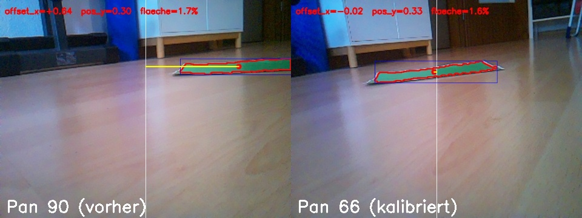
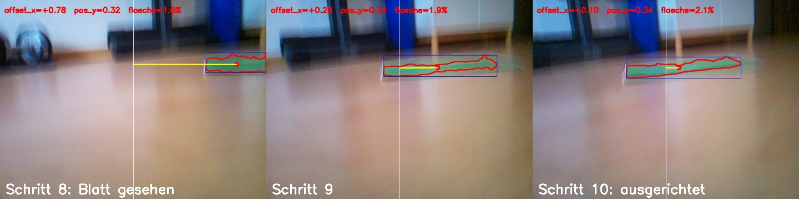

# Übung 5: Blatt suchen und darauf ausrichten

**Skript:** [`pi/align_exercise_1.py`](../../pi/align_exercise_1.py)
**Dauer:** ca. 45–60 Minuten
**Bewegt sich:** **ja**, das Auto dreht sich auf der Stelle
**Voraussetzung:** [Übung 2](cv_exercise_1.md) (Grün-Erkennung) und [Übung 4](turn_exercise_1.md) (Drehen ohne Gyro)

> **Teil A – Lecture:** Theorie und Erklärungen, zum Vortragen oder Selbstlesen.  
> **Teil B – Exercise:** Praxis am Auto, Aufgaben und Lösungen zum Aufklappen.

## Lernziele

- Fertige **Bausteine kombinieren**: Erkennung (Übung 2) + Drehen und Messen (Übung 4)
- Ein **Zustandsautomat** mit zwei Zuständen: SUCHEN und AUSRICHTEN
- **Visual Servoing:** Das Ziel im Bild direkt als Sensor nutzen, statt blind zu zählen
- Warum ein **Regelkreis** mit Rückmeldung genauer ist als eine Vorab-Berechnung

---

## Teil A – Lecture

### Das Problem

Das grüne Blatt liegt irgendwo um das Auto herum, z. B. schräg hinter ihm. Das Auto soll:
1. sich drehen, bis es das Blatt sieht,
2. sich so ausrichten, dass das Blatt **genau vor ihm** liegt (Bildmitte).

### Zwei Zustände

```
          kein Blatt im Bild                    Blatt im Bild
        ┌────────────────────┐            ┌──────────────────────────┐
        │      SUCHEN        │ ─────────▶ │       AUSRICHTEN         │
        │ Impuls in Such-    │  Blatt     │ Winkel zum Blatt aus dem │
        │ richtung drehen,   │  taucht    │ Bild, passend drehen     │
        │ Winkel mitzählen   │  auf       │                          │
        └────────────────────┘ ◀───────── └──────────────────────────┘
          nach 360°: aufgeben   Blatt          |Winkel| ≤ 3°: FERTIG
                                verloren
```

Auch diese Übung arbeitet **schrittweise** (Stop-and-Go): drehen, anhalten, Foto, entscheiden.

### SUCHEN: blind drehen, aber mitzählen

Solange kein Blatt zu sehen ist, dreht das Auto in Impulsen von 0,3 s (~15°) in die Suchrichtung. Wie weit es sich schon gedreht hat, misst es mit der **visuellen Odometrie aus Übung 4**: ORB-Punkte vorher und nachher vergleichen. Schlägt das fehl, z. B. vor einer weißen Wand, wird aus der Drehrate geschätzt. Nach 360° gibt es auf, dann ist offenbar kein Blatt da.

### AUSRICHTEN: das Blatt selbst ist der Sensor

Sobald das Blatt im Bild ist, braucht man keine Odometrie mehr. Der **Winkel zum Blatt** lässt sich direkt aus dem Bild berechnen, mit dem Lochkamera-Modell aus Übung 4:

```python
x_px  = offset_x * 320                       # Abstand zur Bildmitte in Pixeln
angle = degrees(atan(x_px / 634))           # 634 = Brennweite in Pixeln
```

| `offset_x` | Winkel |
|---|---|
| +1,0 (rechter Rand) | +26,8° |
| +0,78 | +21,3° |
| +0,28 | +8,2° |
| 0 (Mitte) | 0° |

Dann dreht das Auto einen Impuls, der **80 % dieses Winkels** entspricht, macht ein neues Foto und misst erneut. Das ist ein **Regelkreis mit Rückmeldung**: Selbst wenn die Reifen rutschen und der Impuls zu kurz oder zu lang war, sieht das nächste Foto, wo das Blatt *wirklich* liegt, und korrigiert.

Diese Technik heißt **Visual Servoing**. Das Ziel im Kamerabild steuert die Bewegung direkt. Sie ist robuster als „Winkel ausrechnen und blind drehen“, weil Fehler sich nicht aufsummieren: Jeder Schritt misst neu gegen das eigentliche Ziel.

### Achtung: Schaut die Kamera wirklich geradeaus?

Das Verfahren richtet das Blatt in der **Bildmitte** aus. Das ist nur dann „vor dem Auto“, wenn die Kamera **genau in Fahrtrichtung** schaut.

Bei diesem Auto ist der Kamerakopf mechanisch verdreht. **Bei Pan 90 schaut er ca. 18° nach links.** Mit Pan 90 stand das Blatt nach dem Ausrichten deshalb deutlich **links** vor dem Auto, und beim Losfahren wäre das Auto rechts daran vorbeigefahren.

```
   Kamera schaut 18° links         Blatt in der Bildmitte
            ╲                               ▓▓
             ╲  ← Blickrichtung            ▓▓
              ╲                    ↑ Fahrtrichtung
              [Auto]               [Auto]  → fährt am Blatt vorbei
```

**Lösung:** Der Pan-Wert, bei dem die Kamera wirklich geradeaus schaut, wird einmal **kalibriert** und zentral in `car_config.py` als `PAN_CENTER` gespeichert. Alle Skripte nutzen diesen Wert.

#### So funktioniert die Kalibrierung (`calibrate_pan.py`)

1. Das Blatt wird **exakt gerade vor das Auto** gelegt. Das ist das bekannte Ziel.
2. Der Kamerakopf fährt durch mehrere Pan-Werte. Bei jedem wird gemessen, wie weit das Blatt neben der Bildmitte liegt.
3. Wo das Blatt **genau in der Mitte** liegt, schaut die Kamera geradeaus.

| Pan | Blatt liegt bei |
|---|---|
| 65 | −0,7° |
| 70 | +3,2° |
| 75 | +7,4° |
| 80 | +11,9° |
| 85 | +16,2° |
| 90 | +17,9° |
| 95 | +19,7° |
| 100 | +21,5° |

Der Nulldurchgang liegt zwischen 65 und 70, interpoliert bei **Pan 66**. Ab Pan 90 wird die Kurve flacher, weil das Blatt an den Bildrand stößt und abgeschnitten wird. Deshalb zählt nur der lineare Bereich (65–85, ~0,85° pro Servo-Einheit).


*Links Pan 90: Das gerade vor dem Auto liegende Blatt hängt am rechten Bildrand. Rechts Pan 66 (kalibriert): Das Blatt liegt genau in der Mitte (−0,5°).*

> **Lehre:** Ein Sensor, der nicht dort hinschaut, wo man denkt, macht jede noch so gute Software falsch. Deshalb kalibriert man vor dem Einsatz: Man misst mit einem **bekannten Ziel** (Blatt exakt vor dem Auto) und rechnet den Fehler heraus.

### Drehrate nachführen

Das Programm startet mit 55°/s (aus Übung 4) und passt die Drehrate laufend an:
- **Suchphase:** aus der gemessenen Odometrie
- **Ausrichtphase:** daraus, wie weit das Blatt im Bild gewandert ist

So werden die Impulse mit der Zeit passender, trotz der schwankenden Reifen.

### Ergebnisse aus dem Testlauf (2026-11-22)

Startposition: Blick auf die Wand, das Blatt liegt ca. 110–120° rechts hinter dem Auto.

| Schritt | Zustand | Was passiert ist |
|---|---|---|
| 1–4 | SUCHEN | je ~16,5° nach rechts, **geschätzt** (weiße Wand, zu wenige Punkte) |
| 5–7 | SUCHEN | 19,0° / 11,4° / 18,4° gemessen, gesamt ~115° |
| 8 | AUSRICHTEN | Blatt gesehen: +21,3° (rechts), `offset_x` +0,78 |
| 9 | AUSRICHTEN | +8,2° |
| 10 | AUSRICHTEN | +2,8° → **ausgerichtet** ✅ |


*Schritt 8: Das Blatt taucht am rechten Bildrand auf. Schritt 9: Nach einem Korrekturimpuls ist es fast mittig. Schritt 10: Es ist mittig, die gelbe Linie zur Bildmitte ist nur noch kurz.*

**Beobachtungen:**
- Die gesuchten ~115° passen gut zur tatsächlichen Lage des Blattes (geschätzt 110–120°).
- Zum Ausrichten reichten **zwei Korrekturimpulse**.
- **Dieser Lauf lief noch mit Pan 90**, also mit ~18° schief schauender Kamera. Das Blatt lag danach in der Bildmitte, aber nicht genau vor dem Auto (siehe oben).
- Der linke, hellere Teil des Blattes wird teilweise nicht erkannt, weil das Licht dort spiegelt und die Farbe blasser ist. Der Schwerpunkt liegt dadurch etwas zu weit rechts. Das Auto zielt also leicht neben die echte Blattmitte.

---

## Teil B – Exercise

### Sicherheit

- Das Auto dreht sich **auf der Stelle**, braucht also nur etwa seinen eigenen Umfang an Platz.
- Höchstens 40 Schritte bzw. 360° Suche, danach bricht das Programm ab.
- Motoren werden im `finally` immer gestoppt.

### Ausprobieren

```
python3 align_exercise_1.py rechts 0       # Trockenlauf: ein Bild auswerten, Motoren aus
python3 align_exercise_1.py rechts 2000    # suchen nach rechts, dann ausrichten
python3 align_exercise_1.py links 2000     # suchen nach links
```

Debug-Bilder: `~/smartcar/debug/align_<schritt>.jpg`, ein Overlay der Erkennung pro Schritt.

### Aufgaben

1. **Trockenlauf:** Das Blatt einmal *vor* und einmal *hinter* das Auto legen. Was gibt der Trockenlauf jeweils aus?
2. **Suchrichtung:** Das Blatt 90° rechts neben das Auto legen. Einmal mit `rechts`, einmal mit `links` suchen. Wie viele Schritte braucht es jeweils?
3. **Tabelle nachrechnen:** Den Winkel für `offset_x = 0,5` mit der Formel ausrechnen und mit der Ausgabe vergleichen.
4. **Toleranz:** `TOLERANCE_DEG` auf 1° setzen. Schafft das Auto das? Was passiert, wenn der Wert kleiner ist als der kleinste mögliche Drehimpuls?
5. **Warum 80 %?** Den Faktor `0.8` in der Impulsberechnung auf 1.2 ändern. Was passiert? *Tipp: Überschwingen.*
6. **Zwei grüne Dinge:** Ein zweites grünes Objekt ins Bild legen. Wohin richtet sich das Auto aus und warum? Wie könnte man das verbessern?
7. **Bonus:** Die Suche verbessern: Statt das ganze Auto zu drehen, zuerst nur den **Kamerakopf** schwenken (Pan 60–150) und nachsehen, ob das Blatt irgendwo zu sehen ist. Dann gezielt dorthin drehen.
8. **Kalibrierung:** Das Blatt exakt vor das Auto legen und `calibrate_pan.py` ausführen. Bei welchem Pan-Wert schaut die Kamera geradeaus? Wie viel Grad Blickwinkel entspricht eine Servo-Einheit?
9. **Bonus:** Das Auto auf das **Blattzentrum aus der Bounding-Box** ausrichten statt auf den Schwerpunkt. Wann ist das besser, wann schlechter?

### Lösungen und Erfahrungswerte (für dieses Auto gemessen)

<details>
<summary>Aufklappen</summary>

1. **Trockenlauf:** Blatt vorne: „Blatt gesehen, X° …“ mit Winkel und Abstand. Blatt hinten: „Trockenlauf: kein Blatt im Bild.“
2. **Suchrichtung:** Bei ~15° pro Suchschritt braucht es nach rechts ~4–5 Schritte bis zum Sichtkontakt (der Bildrand liegt schon ~27° neben der Mitte), nach links dagegen ~16–17 Schritte (~250°).
3. **offset_x = 0,5:** x = 0,5 · 320 = 160 px → atan(160 / 634) ≈ **14,2°**.
4. **Toleranz 1°:** Der kürzeste Impuls (0,08 s) dreht bei ~55°/s schon ~4°, wegen Haftreibung und Nachlauf oft sogar mehr oder gar nicht. Das Auto pendelt dann um das Ziel herum und erreicht 1° evtl. nie, bis `MAX_STEPS` greift.
5. **Faktor 1,2:** Jeder Impuls dreht zu weit, das Blatt springt auf die andere Seite → **Überschwingen**, das Auto pendelt hin und her. Mit 0,8 nähert es sich von einer Seite an.
6. **Zwei grüne Objekte:** Das Programm nimmt die **größte** grüne Fläche. Verbesserungen: Form prüfen (Rechteck? Seitenverhältnis?), Mindestgröße, bekannte Position verfolgen statt jedes Mal neu zu suchen.
8. **Kalibrierung:** **Pan 66** schaut geradeaus. Bei Pan 90 schaut der Kopf ~18° nach links. Größere Werte = links, ~0,85° pro Einheit.
9. **Bounding-Box statt Schwerpunkt:** Wird ein Teil des Blattes nicht erkannt (Reflexion), verschieben sich Schwerpunkt **und** Box. Die Box ist robuster gegen Löcher in der Mitte, aber empfindlicher gegen einzelne Ausreißer-Pixel am Rand.

</details>

---

## Ausblick

In [Übung 6](park_exercise_1.md) fährt das Auto auf das ausgerichtete Blatt zu und parkt darauf.
