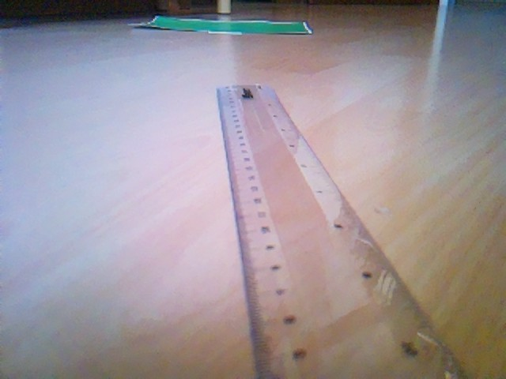
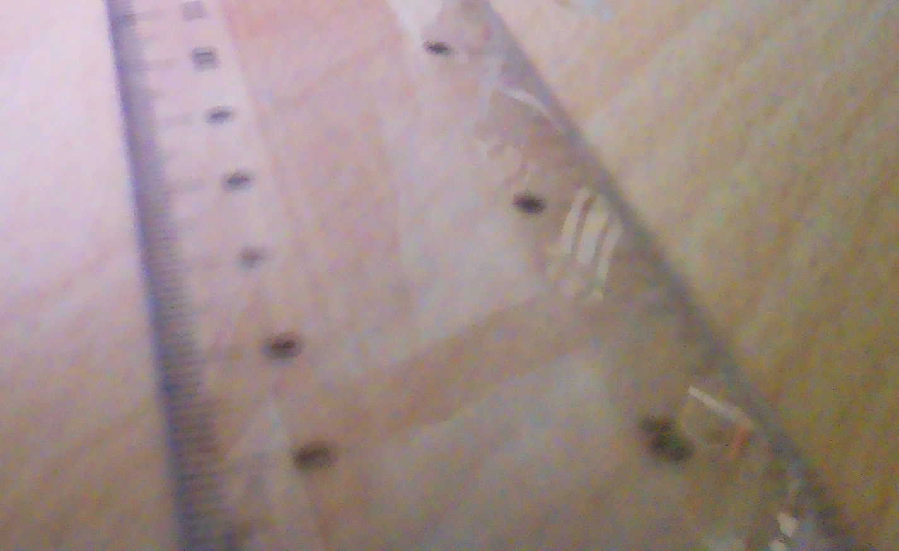
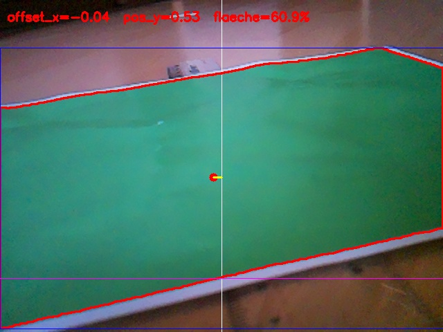
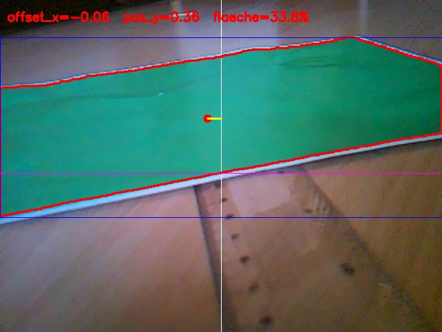
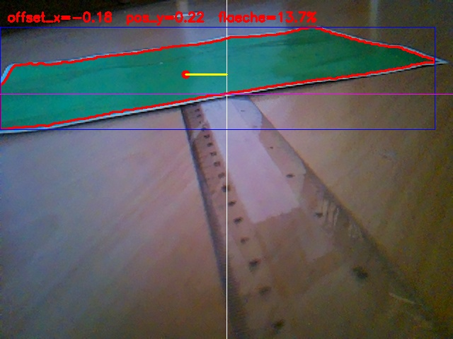
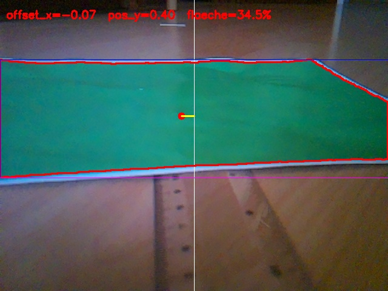

# Übung 5b: Kamera und Fahrzeug kalibrieren

**Skripte:** [`pi/calibrate_pan.py`](../../pi/calibrate_pan.py), [`pi/ground_calibration.py`](../../pi/ground_calibration.py), Werte zentral in [`pi/car_config.py`](../../pi/car_config.py)
**Dauer:** ca. 60–90 Minuten
**Bewegt sich:** Kamerakopf, und für die Geschwindigkeitsmessung einmal kurz das Auto
**Hilfsmittel:** grünes Blatt (DIN A4), Lineal
**Voraussetzung:** [Übung 2](cv_exercise_1.md) (Grün-Erkennung), [Übung 5](align_exercise_1.md) (Ausrichten)

> **Teil A – Lecture:** Theorie und Erklärungen, zum Vortragen oder Selbstlesen.  
> **Teil B – Exercise:** Praxis am Auto, Aufgaben und Lösungen zum Aufklappen.

## Lernziele

- Warum ein Programm **reale Messwerte** braucht und wie man sie gewinnt
- Ein **geometrisches Modell** aufstellen: Bildzeile → Abstand auf dem Boden
- Modellparameter aus Messpunkten **fitten** (kleinste Quadrate)
- Warum zwei Messpunkte **immer** perfekt passen und trotzdem falsch sein können
- **Korrelierte Parameter**: Wenn sich zwei Unbekannte gegenseitig ausgleichen
- Ergebnisse **unabhängig gegenprüfen**, mit einer Vorhersage und einem zweiten Experiment

---

## Teil A – Lecture

### Warum kalibrieren?

Für das Parken (Übung 6) muss das Auto die letzten Zentimeter **blind** fahren, weil die Kamera das Blatt dann nicht mehr sieht. Wie weit, rechnet es aus:

```
rest_cm = toter Winkel + Blattlänge / 2 − Abstand Linse→Automitte
rest_s  = rest_cm / Geschwindigkeit
```

Jeder dieser Werte ist eine **Eigenschaft der echten Hardware**. Im Code stehen sie als Konstanten, und wenn eine davon falsch ist, parkt das Auto daneben. Kalibrieren heißt: diese Werte **messen**, statt sie zu raten.

Alle Werte stehen an **einer** Stelle, in `pi/car_config.py`. So muss man sie nach einer Änderung am Auto nur dort neu eintragen.

### 1. Wohin schaut die Kamera? (Pan-Nullpunkt)

Ausführlich in [Übung 5](align_exercise_1.md): Der Kamerakopf ist verdreht, bei Pan 90 schaut er ~18° nach links. Mit dem Blatt **exakt vor dem Auto** als bekanntem Ziel ergab `calibrate_pan.py`: **geradeaus = Pan 66**.

Der Kopf ist außerdem **mechanisch instabil**. Kabel verschieben sich und verkippen ihn, und nach dem Nachziehen der Schrauben kann der Nullpunkt anders liegen. → Vor jeder Session kurz prüfen.

### 2. Wie schnell fährt das Auto?

Einfachster Versuch: 1,0 s mit Speed 1500 geradeaus fahren und die Strecke messen. Ergebnis: **~50 cm, also 50 cm/s**.

Aber Vorsicht: In der Sekunde steckt auch das **Anfahren**. Das Auto braucht einen Moment, bis es auf Tempo ist. Bei einem sehr kurzen Impuls (z. B. 0,16 s) kommt es vermutlich nicht auf volle Geschwindigkeit und fährt **weniger** als 50 cm/s × Zeit. Genauer wäre es, mehrere Impulslängen zu messen (0,2 / 0,5 / 1,0 s) und eine Kurve daraus zu machen.

### 3. Der tote Winkel: Was sieht die Kamera direkt vor dem Auto?

Bei Tilt 110 schaut die Kamera schräg nach unten. Direkt vor dem Auto gibt es trotzdem einen Streifen Boden, den sie **nicht** sieht.

```
   Linse ◉
         │╲
   h     │  ╲  unterer Bildrand
         │    ╲
  ═══════╧══════╲═══════════  Boden
         │◀────▶│
         toter Winkel
```

#### Erster Versuch: Lineal ablesen

Idee: Ein Lineal vor das Auto legen und ablesen, welcher Zentimeterstrich gerade noch unten im Bild ist.


*Lineal vor dem Auto bei Tilt 110. Das Lineal ist gut zu sehen, die Ziffern aber nicht zu lesen.*


*Ausschnitt in voller Auflösung (2592×1944): Der Nahbereich ist unscharf. Die Pi-Kamera v1 hat einen **festen Fokus**, der auf größere Entfernungen eingestellt ist. Ziffern direkt vor der Linse sind nicht lesbar.*

Dazu kam ein zweites Problem: Auf einem früheren Bild lief der Boden deutlich **schräg** durchs Bild. Die Kabel hatten den Kamerakopf verkippt (siehe Übung 5). Die Kabel wurden mit Klebeband fixiert und die Halterung leicht nachgebogen.

#### Besser: das grüne Blatt als Messmarke

Die Kante des grünen Blattes erkennt das Programm **pixelgenau**. Also wird das Blatt mit seiner vorderen Kante auf bekannte Abstände gelegt (5 / 10 / 20 cm am Lineal), und das Programm notiert jeweils, in welcher **Bildzeile** die Kante erscheint.

| 5 cm | 10 cm | 20 cm |
|---|---|---|
|  |  |  |

*Die violette Linie markiert die gemessene Kante.*

**Wichtig: in der Bildmitte messen, nicht die Bounding-Box nehmen.** Liegt das Blatt minimal schräg oder ist das Bild leicht verkippt, läuft die Kante schräg durchs Bild. Die Unterkante der Bounding-Box wäre dann eine **Ecke** des Blattes. Deshalb wird die unterste grüne Zeile in der **mittleren Bildspalte** genommen, also genau dort, wo das Lineal liegt.


*Erste Messung: Die Kante liegt links bei y ≈ 292 und rechts bei y ≈ 265. Die Bounding-Box hätte 292 geliefert, in der Mitte sind es 273.*

**Noch ein Detail:** Die Linse sitzt nicht genau über der Vorderkante des Autos, sondern **~1,75 cm dahinter**. Gemessen wird am Lineal ab der Autokante, das Skript rechnet den Versatz dazu.

| Lineal (ab Autokante) | ab Linse | Bildzeile y (von 480) |
|---|---|---|
| 5 cm | 6,75 cm | 402 |
| 10 cm | 11,75 cm | 250 |
| 20 cm | 21,75 cm | 133 |

Schon ohne Modell sieht man: Selbst bei 5 cm ist die Kante noch weit über dem unteren Bildrand. **Der tote Winkel ist kleiner als 5 cm.**

### 4. Das Modell: Bildzeile → Bodenabstand

Wieder das **Lochkamera-Modell** aus Übung 4, diesmal senkrecht statt waagerecht:

- Die Kamera hängt in Höhe **h** über dem Boden und ist um den Winkel **α** nach unten geneigt.
- Eine Bildzeile **y** liegt um den Winkel `β = atan((y − 240) / f)` unter der Bildmitte (240 = halbe Bildhöhe, f = Brennweite in Pixeln).
- Der Sehstrahl trifft den Boden also unter dem Winkel `α + β`, und es gilt:

```
          h
d(y) = ────────────────────
        tan(α + β(y))
```

```
   Linse ◉ ── ── ── ── ── ── waagerecht
         │ ╲  α + β
     h   │   ╲
         │     ╲
  ═══════╧═══════●════  Boden
         │◀── d ──▶│
```

Drei Unbekannte: **h**, **α**, **f**. Die Messpunkte sollen sie liefern.

### 5. Was beim Fitten schiefging, und was man daraus lernt

#### Versuch 1: zwei Punkte, Brennweite aus dem Datenblatt

Mit f = 634 px (Datenblatt) und den ersten zwei Punkten ergab der Fit: **Kamerahöhe 50 cm, toter Winkel −5,6 cm**. Beides ist offensichtlich Unsinn.

**Warum?** Zwei Punkte, zwei Unbekannte (h, α): Es gibt **immer** eine Lösung, die exakt passt (Restfehler 0,00 cm). Ein perfekter Fit beweist gar nichts. Hier gab es sogar **zwei** mathematische Lösungen (h ≈ 4 cm oder h ≈ 50 cm), und der Algorithmus fand die falsche.

> **Lehre 1:** Mit genauso vielen Messpunkten wie Unbekannten passt das Modell immer. Erst ein **zusätzlicher** Punkt kann zeigen, ob es stimmt.

#### Versuch 2: Kamerahöhe gemessen, Brennweite fitten

Die Höhe der Linse wurde mit dem Lineal gemessen: „etwa 7 cm“. Mit h = 7 und drei Punkten ergab sich f = 525 px, also **63° Bildwinkel** statt 53,5° laut Datenblatt.

Die Vorhersage für den dritten Punkt (aus den ersten beiden) lag bei 20,5 cm statt 21,75 cm. Nicht schlecht, aber: **Mit 63° Bildwinkel hätte Übung 4 falsch gemessen.** Das Auto hätte sich bei „90°“ in Wirklichkeit über 100° drehen müssen. Beobachtet wurde aber „knapp unter 90°“. Zwei Experimente widersprechen sich, also stimmt irgendwo eine Annahme nicht.

#### Die Auflösung: korrelierte Parameter

Ein Test, wie gut das Modell bei **verschiedenen angenommenen Kamerahöhen** passt:

| angenommene Höhe h | gefittete Brennweite f | Bildwinkel | Restfehler | toter Winkel (ab Autokante) |
|---|---|---|---|---|
| 5 cm | 655 px | 52° | 0,07 cm | 3,7 cm |
| 6 cm | 575 px | 58° | 0,04 cm | 3,5 cm |
| 7 cm | 525 px | 63° | 0,11 cm | 3,3 cm |
| 8 cm | 490 px | 66° | 0,20 cm | 3,1 cm |
| 10 cm | 455 px | 70° | 0,37 cm | 2,7 cm |
| 12 cm | 445 px | 71° | 0,53 cm | 2,4 cm |

**Alle** Kombinationen erklären die Messpunkte fast gleich gut. Eine tiefe Kamera mit langer Brennweite sieht im Nahbereich fast genauso aus wie eine hohe Kamera mit kurzer Brennweite. Die beiden Parameter sind **korreliert**: Die Messungen legen nur ihre Kombination fest, nicht jeden einzeln.

> **Lehre 2:** Wenn sich zwei Unbekannte gegenseitig ausgleichen können, lassen sie sich aus diesen Messungen nicht trennen. Man braucht entweder Messpunkte in einem ganz anderen Bereich (z. B. weit weg) oder **unabhängiges Wissen** über einen der Parameter.

**Gute Nachricht:** Der **tote Winkel** schwankt in der Tabelle nur zwischen 2,4 und 3,7 cm. Für das Parken ist er der wichtige Wert, und der ist **robust**, egal welche Kombination stimmt.

#### Versuch 3: Brennweite festhalten, Höhe fitten

Unabhängiges Wissen gibt es: In **Übung 4** wurde die Brennweite (über den Bildwinkel 53,5°) schon geprüft, denn die Drehungen kamen ziemlich genau bei 90° an. Also: **f = 634 px festhalten, h und α fitten.**

| | Ergebnis |
|---|---|
| Kamerahöhe (Linsenmitte) | **5,2 cm** |
| Neigung bei Tilt 110 | **23,0°** unter waagerecht |
| Restfehler | **0,05 cm** |
| **toter Winkel** | **5,4 cm ab Linse = 3,7 cm ab Autokante** |

Die mit dem Lineal gemessenen „etwa 7 cm“ waren also zu viel. Bei einer **geneigten** Kamera ist schwer zu sagen, wo genau die „Linsenmitte“ ist. Misst man bis zur Oberkante des Gehäuses, kommen schnell 2 cm zu viel heraus.

> **Lehre 3:** Ein Messwert, den man „so ungefähr“ abgelesen hat, kann der ungenaueste Teil der ganzen Rechnung sein. Ergebnisse aus **verschiedenen Experimenten** (hier Drehen und Boden) müssen zusammenpassen. Wenn nicht, sucht man die schwächste Annahme.

### 6. Gegenprobe: Wie lang ist das Blatt?

Mit dem fertigen Modell kann das Programm für **jede** Bildzeile den Bodenabstand ausrechnen:

| Bildzeile y | 480 (unten) | 400 | 300 | 240 (Mitte) | 180 | 120 | 60 |
|---|---|---|---|---|---|---|---|
| Abstand ab Autokante | 4 cm | 5 cm | 8 cm | 11 cm | 15 cm | 22 cm | 40 cm |

Gegenprobe am 5-cm-Bild: Die vordere Blattkante (y = 398) liegt laut Modell bei **5,2 cm**, die hintere (y = 108) bei **24,4 cm**. Das Blatt ist also **~19 cm** lang in Fahrtrichtung. Ein DIN-A4-Blatt **quer** hat 21 cm. Die knapp 2 cm Unterschied kommen von den unscharfen Kanten. Das Modell funktioniert also auch **außerhalb** der Messpunkte, und nebenbei zeigt es, dass das Blatt quer liegt.

### 7. Ergebnis für das Parken

| Wert | Kalibriert | Woher |
|---|---|---|
| Geschwindigkeit | 50 cm/s | 1 s fahren, Strecke messen |
| Toter Winkel | 5,4 cm ab Linse | Boden-Kalibrierung |
| Linse vor Automitte | 7,75 cm | Auto 19 cm lang → Mitte 9,5 cm hinter der Vorderkante, minus 1,75 cm |
| Blattlänge in Fahrtrichtung | 21 cm | DIN A4 quer (Gegenprobe im Bild: ~19 cm) |

```
rest = 5,4 + 21/2 + 7,75 = 23,65 cm   →   23,65 / 50 + 0,12 = 0,59 s blind fahren
```

**Nachtrag nach den Tests:** Hier stand ursprünglich `5,4 + 21/2 − 7,75 = 8,15 cm`, also mit einem **Vorzeichenfehler**: Die Kamera sitzt vor der Automitte, die Automitte muss die 7,75 cm also zusätzlich fahren. Und das befürchtete Risiko trat ein: Kurze Impulse fahren weniger als 50 cm/s × Zeit. Zwei Parkläufe ergaben einen **Anfahrverzug von ~0,12 s** (Details in [Übung 6](park_exercise_1.md)). Die Kalibrierung war also nicht falsch, aber unvollständig: Eine Geschwindigkeit allein beschreibt das Fahrverhalten nicht.

---

## Teil B – Exercise

### Sicherheit

- Pan- und Boden-Kalibrierung bewegen **nur den Kamerakopf**.
- Die Geschwindigkeitsmessung fährt das Auto vorwärts. Vorher Platz prüfen: Bei Speed 1500 legt es in 1 s ~50 cm zurück!

### Ausprobieren

```
# Pan-Nullpunkt (Blatt exakt gerade vor das Auto, 50–100 cm)
python3 calibrate_pan.py 65 100 5

# Boden-Kalibrierung (Blatt-Vorderkante auf 5, 10, 20 cm ab Autokante legen)
python3 ground_calibration.py reset
python3 ground_calibration.py messen 5
python3 ground_calibration.py messen 10
python3 ground_calibration.py messen 20
python3 ground_calibration.py auswerten
```

Debug-Bilder: `~/smartcar/debug/calpan_<pan>.jpg`, `~/smartcar/debug/ground_<abstand>cm.jpg`

### Aufgaben

1. **Pan prüfen:** Blatt gerade vor das Auto legen und `align_exercise_1.py rechts 0` (Trockenlauf) starten. Liegt das Blatt bei ~0°? Wenn nicht: neu kalibrieren.
2. **Geschwindigkeit:** Mit 0,2 s, 0,5 s und 1,0 s fahren und jeweils die Strecke messen. Ist die Geschwindigkeit konstant? Was bedeutet das für den 0,16-s-Impuls beim Parken?
3. **Boden-Kalibrierung:** Die drei Messpunkte aufnehmen und auswerten. Wie groß ist der tote Winkel?
4. **Zwei Punkte reichen nicht:** Nur mit 2 Punkten auswerten und dann den dritten vorhersagen. Wie groß ist der Fehler?
5. **Korrelation selbst sehen:** Im Skript die Brennweite auf 525 px statt 634 px setzen und neu auswerten. Wie ändert sich die Kamerahöhe? Wie ändert sich der tote Winkel?
6. **Höhe messen:** Die Linsenhöhe mit dem Lineal möglichst genau messen. Passt sie zu den 5,2 cm aus dem Fit?
7. **Anderer Tilt:** Die Boden-Kalibrierung bei Tilt 100 wiederholen. Wie groß ist dort der tote Winkel? Warum ist er größer?
8. **Bonus – weit weg:** Einen Messpunkt bei 50 cm oder 1 m aufnehmen. Hilft er, Höhe und Brennweite zu trennen? Warum?
9. **Bonus – Abstand zum Blatt:** Mit dem Modell im Programm ausrechnen, wie weit das Blatt beim Anfahren noch entfernt ist, statt nur `pos_y` zu verwenden.

### Lösungen und Erfahrungswerte (für dieses Auto gemessen)

<details>
<summary>Aufklappen</summary>

1. **Pan:** Kalibriert auf 66. Nach Änderungen am Kopf (Schrauben, Kabel) unbedingt neu prüfen.
2. **Geschwindigkeit:** 1,0 s → ~50 cm. Kurze Impulse fahren deutlich weniger: Aus den Parkläufen ergibt sich ein Anfahrverzug von ~0,12 s, also `strecke ≈ 50 cm/s × (t − 0,12 s)`. Für 0,16 s sind das nur ~2 cm statt 8 cm.
3. **Toter Winkel:** 5,4 cm ab Linse = **3,7 cm ab Autokante** (Tilt 110).
4. **Zwei Punkte:** Fit aus 5 und 10 cm → Vorhersage für 20 cm: 20,5 cm statt 21,75 cm ab Linse (1,25 cm daneben). Mit fester Brennweite und unbekannter Höhe fand der 2-Punkt-Fit sogar eine völlig falsche Lösung (h = 50 cm).
5. **Korrelation:** Mit f = 525 ergibt sich h ≈ 7 cm, mit f = 634 h ≈ 5,2 cm. Der tote Winkel ändert sich dabei nur von 3,3 auf 3,7 cm ab Autokante.
6. **Höhe:** Grob gemessen „etwa 7 cm“, der Fit sagt 5,2 cm. Bei einer geneigten Kamera ist die Linsenmitte schwer zu treffen.
7. **Tilt 100:** Die Kamera schaut flacher, der untere Bildrand trifft den Boden weiter vorne → größerer toter Winkel.
8. **Weit weg:** Ja. Weit entfernte Punkte liegen nahe am Horizont. Dort hängt die Bildzeile fast nur von α und f ab, kaum von h. So lassen sich die Parameter besser trennen.

</details>
