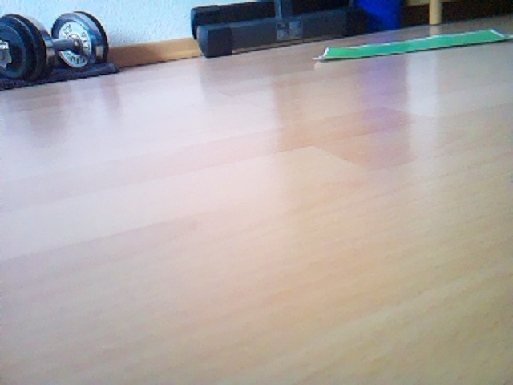
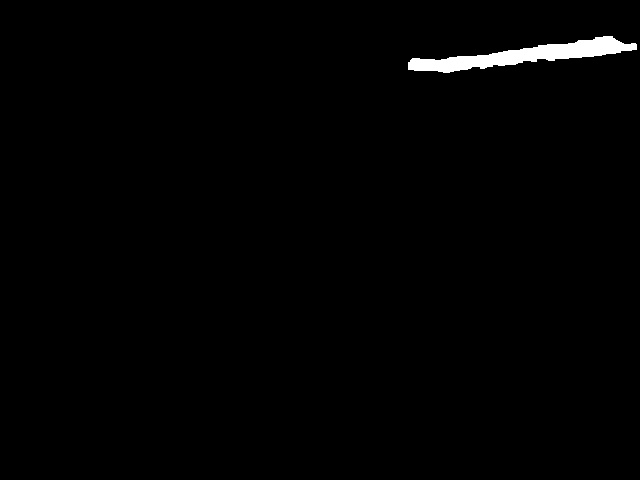
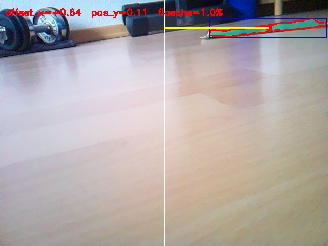
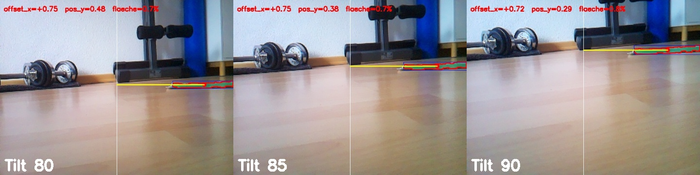
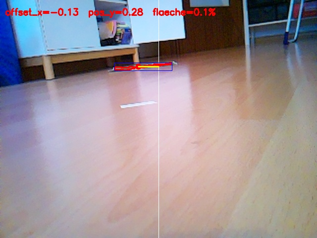
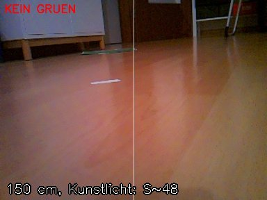

# Übung 2: Grünes Blatt erkennen

**Skript:** [`pi/cv_exercise_1.py`](../../pi/cv_exercise_1.py)
**Dauer:** ca. 45–60 Minuten
**Bewegt sich:** nur der Kamerakopf, nicht die Räder
**Voraussetzung:** [Übung 1](head_movement_exercise_1.md). Der Suchwinkel der Kamera sollte bekannt sein.

> **Teil A – Lecture:** Theorie und Erklärungen, zum Vortragen oder Selbstlesen.  
> **Teil B – Exercise:** Praxis am Auto, Aufgaben und Lösungen zum Aufklappen.

## Lernziele

- Warum man für Farberkennung den **HSV-Farbraum** statt RGB verwendet
- Wie man aus einem Bild eine **Maske** macht (Pixel ist grün: ja oder nein)
- Wie man Störungen mit **Morphologie** entfernt
- Wie man mit **Konturen** und **Momenten** Position und Größe eines Objekts bestimmt
- Wie aus einem Bild **Zahlen** werden, mit denen ein Roboter Entscheidungen treffen kann

---

## Teil A – Lecture

### Was das Skript macht

Aufruf: `python3 cv_exercise_1.py [tilt] [pan]` (Standard: 90 90)

#### Schritt 1: Foto aufnehmen
Die Servos fahren auf Tilt und Pan, dann nimmt die Kamera ein Bild mit 640×480 Pixeln auf. Für OpenCV ist ein Bild einfach ein Zahlen-Array der Form `(480, 640, 3)`: Höhe × Breite × Farbkanäle.

#### Schritt 2: Von BGR nach HSV umrechnen
```python
hsv = cv2.cvtColor(frame, cv2.COLOR_BGR2HSV)
```
Im RGB- bzw. BGR-Format ist ein Pixel eine Mischung aus Rot, Grün und Blau. „Grün“ lässt sich darin schlecht beschreiben. Ein dunkles Grün und ein helles Grün haben völlig verschiedene RGB-Werte.

Im **HSV**-Farbraum hat jedes Pixel drei andere Werte:
| Wert | Bedeutung | Bereich in OpenCV |
|---|---|---|
| **H** (Hue) | Farbton: rot → gelb → grün → blau → rot | 0–179 |
| **S** (Saturation) | Sättigung: grau → kräftig | 0–255 |
| **V** (Value) | Helligkeit: schwarz → hell | 0–255 |

„Grün“ ist dann einfach **ein Bereich von H**, unabhängig davon, ob es im Schatten oder im Licht liegt.

#### Schritt 3: Maske bilden
```python
mask = cv2.inRange(hsv, (35, 35, 40), (95, 255, 255))
```
Jedes Pixel mit H 35–95, S ≥ 35 und V ≥ 40 wird **weiß** (255), alles andere **schwarz** (0).
- **S ≥ 35** wirft graue und weiße Flächen raus, z. B. Wände und Reflexe. Ursprünglich lag die Grenze bei 60, siehe Nachtrag 2 (Kunstlicht).
- **V ≥ 40** wirft sehr dunkle Bereiche raus. Dort ist der Farbton unzuverlässig.

#### Schritt 4: Aufräumen (Morphologie)
```python
mask = cv2.morphologyEx(mask, cv2.MORPH_OPEN, np.ones((3, 3)))    # Öffnen
mask = cv2.morphologyEx(mask, cv2.MORPH_CLOSE, np.ones((5, 15)))  # Schließen (breit, flach)
```
- **Öffnen** entfernt einzelne weiße Störpunkte (Rauschen).
- **Schließen** füllt kleine schwarze Löcher im Blatt, z. B. von Lichtreflexen.

#### Schritt 5: Größte grüne Fläche finden
```python
contours, _ = cv2.findContours(mask, cv2.RETR_EXTERNAL, cv2.CHAIN_APPROX_SIMPLE)
biggest = max(contours, key=cv2.contourArea)
```
Eine **Kontur** ist der Umriss einer zusammenhängenden weißen Fläche. Das Skript nimmt die größte, denn das ist vermutlich das Blatt. Ist sie kleiner als 0,05 % des Bildes (154 Pixel), gilt das als „kein Blatt gefunden“ (ursprünglich 0,2 %, siehe Nachträge).

#### Schritt 6: Kennzahlen berechnen
Aus den **Momenten** der Kontur ergibt sich ihr Schwerpunkt `(cx, cy)`. Daraus berechnet das Skript:

| Kennzahl | Bereich | Bedeutung | Wofür später? |
|---|---|---|---|
| `offset_x` | −1 … +1 | Abstand des Blattes von der Bildmitte (− = links, + = rechts) | **Drehrichtung** |
| `pos_y` | 0 … 1 | Höhe im Bild (0 = oben/weit weg, 1 = unten/nah) | **Entfernung** |
| Fläche | % | Anteil des Bildes, der grün ist | Plausibilität, Nähe |

#### Schritt 7: Debug-Bilder speichern
| Datei | Inhalt |
|---|---|
| `cv1_raw.jpg` | Originalfoto |
| `cv1_mask.jpg` | Schwarz-Weiß-Maske: so „sieht“ das Programm das Grün |
| `cv1_overlay.jpg` | Foto mit rotem Umriss, Schwerpunkt-Punkt und gelber Linie von der Bildmitte zum Blatt |

### Ergebnisse (2026-11-22)

**Originalbild, Maske und Erkennung** (Tilt 100, Blatt weit weg rechts):

| Original (`cv1_raw.jpg`) | Maske (`cv1_mask.jpg`) |
|---|---|
|  |  |


*Rot = Umriss des Blattes, Punkt = Schwerpunkt, gelbe Linie = Abstand zur Bildmitte (`offset_x = +0,64`, liegt rechts).*

**Gleiches Blatt bei verschiedenen Kamerawinkeln:**


*Tilt 80 / 85 / 90: Je flacher die Kamera schaut, desto tiefer liegt das Blatt im Bild (`pos_y` 0,29 → 0,48). Tilt 90 ist ein guter Suchwinkel.*

---

### Nachtrag: Das Blatt aus 150 cm Entfernung

Später (in Übung 6) lag das Blatt **150 cm** vor dem Auto, und die Erkennung fand es **nicht**, obwohl es im Bild klar zu sehen war:


*Nach der Korrektur erkannt: ein flacher Streifen von nur ~116 × 17 Pixeln, 0,1 % des Bildes.*

Die Diagnose ergab **drei Ursachen auf einmal**:

| Problem | Messwert | Lösung |
|---|---|---|
| **Mindestfläche zu groß** | Blatt hat nur ~540 Pixel, die Mindestfläche lag bei 614 (0,2 %) | auf **0,1 %** (307 Pixel) gesenkt |
| **Öffnen mit 5×5 frisst dünne Streifen** | Der Streifen ist nur ~5–6 Pixel hoch. Nach 5×5-Öffnen blieben 222 von 541 Pixeln. | **3×3** zum Öffnen |
| **Blatt in zwei Stücke zerfallen** | Ein Lichtreflex teilt den Streifen, jedes Stück hat ~270 Pixel und liegt damit unter der Mindestfläche | Schließen mit einem **breiten, flachen Filter (15 breit × 5 hoch)**, der waagerechte Lücken überbrückt |

Außerdem ist die Farbe aus der Ferne **blasser**: Die Sättigung liegt bei ~96 statt 170–205 aus der Nähe. Mit der Untergrenze S ≥ 60 reicht das noch.

Später wurde die Mindestfläche noch einmal auf **0,05 %** gesenkt: Mit 0,1 % lag das ferne Blatt (300–470 Pixel) genau an der Grenze und wurde mal erkannt, mal nicht. Fehlalarme durch kleine Flecken fängt seitdem der Horizont- und Formfilter aus Übung 5 ab.

> **Lehre:** Ein Erkennungsverfahren, das man nur aus einer Entfernung getestet hat, ist nicht fertig. Die Parameter (Filtergröße, Mindestfläche) müssen zum **kleinsten** Fall passen, den man noch erkennen will. Und nach jeder Änderung prüft man, dass die alten Fälle noch funktionieren (hier: Bilder ohne Blatt bleiben ohne Treffer).

### Nachtrag 2: Abends bei Kunstlicht

Am Abend musste in der Wohnung das Licht angeschaltet werden, und plötzlich fand das Auto das Blatt aus 150 cm nicht mehr, obwohl es im Bild zu sehen war:


*Das Blatt liegt links vorne als blasser Streifen im Bild, die Erkennung meldet „KEIN GRUEN“.*

Die Kamera meldet in ihren Metadaten, warum:

| Messwert | Tageslicht | Kunstlicht abends |
|---|---|---|
| Helligkeit (Lux-Schätzung) | deutlich heller | **57 Lux** |
| Farbtemperatur | ~5000 K | **2430 K** (sehr warm, das Bild wird rotstichig) |
| Verstärkung (Gain) | klein | **8,0 = Maximum** (Bild rauscht) |
| Belichtungszeit | wenige ms | **33 ms** (jede Bewegung verwischt) |
| Sättigung des Blattes aus 150 cm | ~96 | **~48** (Median, ein Viertel der Pixel unter 34) |

Mit S ≥ 60 blieben vom Blatt nur Krümel übrig. Die Lösung: **S ≥ 35**. Der Boden hat zwar inzwischen selbst eine hohe Sättigung (rotstichig), aber einen ganz anderen **Farbton** (H 0–18). Der Farbton trennt Blatt und Boden auch bei schlechtem Licht zuverlässig. Mit S ≥ 35 wird das Blatt im selben Bild als ein Stück erkannt (86 × 11 Pixel).

> **Lehre:** Licht ist ein Parameter, auch wenn er nicht im Code steht. Wer nur bei Tageslicht testet, hat bei Kunstlicht ein anderes System. Gute Merkmale (hier: der Farbton H) sind robust gegen Licht, schwache (hier: die Sättigung S) nicht.

**Messfehler am Rande:** Die erste Messung der Sättigung erfolgte auf den gespeicherten Debug-Bildern. Dort sind aber Kontur und Linien **eingezeichnet**, und die Bilder sind stark komprimiert. Das verfälscht die Farbwerte. Für Farbmessungen immer das **Rohbild** verwenden.

## Teil B – Exercise

### Aufbau

Ein grünes Blatt Papier ein bis zwei Meter vor das Auto auf den Boden legen, gerne etwas seitlich versetzt.

### Aufgaben

1. **Erster Lauf:** Skript starten und alle drei Bilder ansehen. Wird das Blatt erkannt? Stimmt `offset_x` mit dem überein, was man im Bild sieht?
2. **Blatt verschieben:** Das Blatt nach links, in die Mitte und näher heranlegen. Wie verändern sich `offset_x`, `pos_y` und die Fläche?
3. **Farben messen:** Die HSV-Werte einzelner Pixel ausgeben:
   ```python
   hsv = cv2.cvtColor(cv2.imread("cv1_raw.jpg"), cv2.COLOR_BGR2HSV)
   print(hsv[y, x])   # Achtung: erst Zeile (y), dann Spalte (x)!
   ```
   Welchen H-Wert hat das Blatt? Welchen der Boden?
4. **Grenzen testen:** Die Obergrenze von H auf 85 senken und das Skript erneut laufen lassen. Was passiert mit der Maske?
5. **Störquellen:** Etwas Blaues und etwas Gelbes ins Bild legen. Wird es fälschlich erkannt? Welche Grenze müsste man anpassen?
6. **Kamerawinkel:** Das Skript mit Tilt 80, 90 und 100 laufen lassen. Bei welchem Winkel ist das Blatt am besten zu sehen? Warum sieht ein weit entferntes Blatt immer wie ein flacher Streifen aus? *Tipp: Wie hoch sitzt die Kamera über dem Boden?*
7. **Bonus:** Statt nur der größten Kontur alle Konturen über einer Mindestgröße einzeichnen. Wann wäre das sinnvoll?
8. **Bonus:** Ein anderes Blatt in Rot verwenden. *Achtung:* Rot liegt bei H ≈ 0 **und** H ≈ 179. Wie baut man dafür eine Maske? (Tipp: zwei `inRange` mit `cv2.bitwise_or` verbinden)

### Lösungen und Erfahrungswerte (für dieses Auto gemessen)

<details>
<summary>Aufklappen</summary>

- **Gemessene HSV-Werte:**
  | Objekt | H | S | V |
  |---|---|---|---|
  | Grünes Testblatt | 80–87 | 170–205 | 160–175 |
  | Laminatboden | ~8 | ~36 | ~222 |
  | Blaue Faszienrolle | > 100 | – | – |
- **Aufgabe 4:** Mit H ≤ 85 zerfiel das Blatt in mehrere Stücke, weil es eher **blaugrün** ist (H bis 87). Nur ein kleines Stück wurde erkannt, und `offset_x` war falsch. Lehre: **Farbgrenzen immer am echten Objekt messen.**
- **Aufgabe 6:** Blatt weit weg, schräg rechts:
  | Tilt | pos_y | Fläche |
  |---|---|---|
  | 80 | 0,48 | 0,7 % |
  | 85 | 0,38 | 0,7 % |
  | 90 | 0,29 | 0,8 % |
  | 100 | 0,11 | 1,0 % |
  Bei Tilt 100 klebt das Blatt am oberen Bildrand. **Tilt 90** ist ein guter Suchwinkel. Die Kamera sitzt nur ca. 10 cm über dem Boden, deshalb sieht man ein entferntes Blatt sehr flach von der Seite.

</details>

---

## Ausblick

Bisher macht das Skript **ein** Foto und wertet es aus. In der nächsten Übung läuft die Erkennung in einer **Schleife**, und `offset_x` steuert die Motoren: Liegt das Blatt rechts, dreht das Auto nach rechts, bis `offset_x ≈ 0` ist. Das ist ein einfacher **Regelkreis**.
