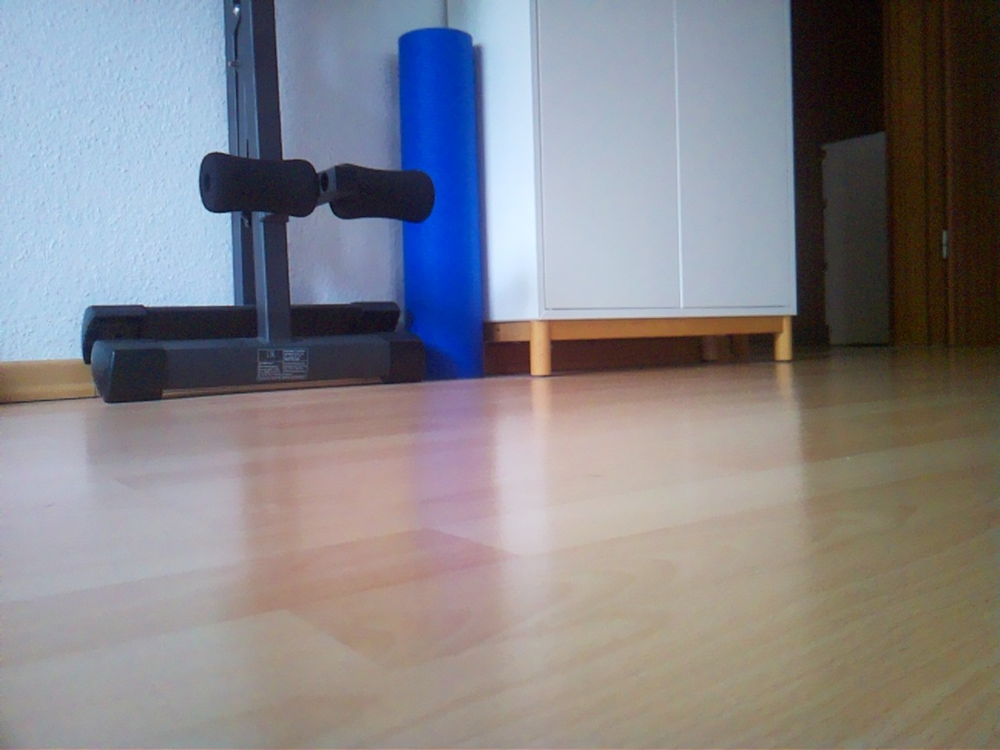
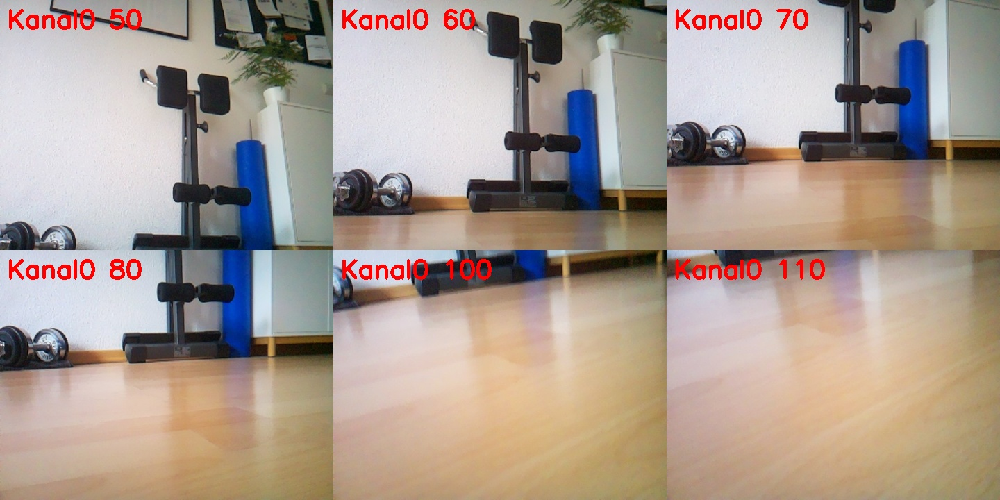
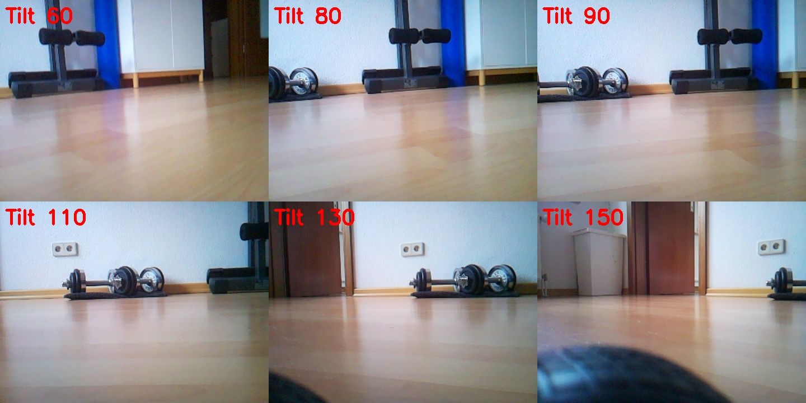

# Übung 1: Kamerakopf bewegen

**Skript:** [`pi/head_movement_exercise_1.py`](../../pi/head_movement_exercise_1.py)
**Dauer:** ca. 20–30 Minuten
**Bewegt sich:** nur der Kamerakopf, nicht die Räder

> **Teil A – Lecture:** Theorie und Erklärungen, zum Vortragen oder Selbstlesen.  
> **Teil B – Exercise:** Praxis am Auto, Aufgaben und Lösungen zum Aufklappen.

## Lernziele

- Wie ein **Servo** angesteuert wird (Winkel statt Geschwindigkeit)
- Wie man mit der Pi-Kamera per **picamera2** ein Foto macht
- Wie man **systematisch misst**, statt der Dokumentation blind zu vertrauen

---

## Teil A – Lecture

### Hintergrund

Die Kamera des SmartCars sitzt auf zwei Servos:
- **Tilt** neigt die Kamera nach oben oder unten.
- **Pan** schwenkt sie nach links oder rechts.

Ein Servo ist ein kleiner Motor mit eingebauter Positionsregelung. Man gibt ihm einen **Winkel** vor, z. B. 90°, und er fährt genau dorthin und hält die Position.

Welcher Kanal welcher Servo ist und in welche Richtung „größer“ geht, hängt vom Zusammenbau ab. **Genau das findet diese Übung heraus.**

### Was das Skript macht

Aufruf: `python3 head_movement_exercise_1.py <kanal> <winkel1> <winkel2> ...`

1. Die Kamera starten (640×480 Pixel).
2. Für jeden angegebenen Winkel:
   1. Den Servo auf diesen Winkel fahren: `servo.setServoPwm(kanal, winkel)`
   2. 0,8 Sekunden warten, bis der Servo still steht. Sonst wird das Foto unscharf.
   3. Ein Foto speichern: `~/smartcar/debug/scan_<kanal>_<winkel>.jpg`
3. Am Ende den Servo zurück auf 90° fahren. Das steht im `finally`-Block und passiert deshalb **auch bei einem Fehler oder Abbruch**.

---

## Teil B – Exercise

### Sicherheit

- Servos haben **mechanische Anschläge**. Fährt man über den möglichen Bereich hinaus, brummt der Servo und kann Schaden nehmen. Neue Winkel deshalb in kleinen Schritten ausprobieren.
- Getestete Bereiche: Tilt 50–110, Pan 60–150.

### Ausprobieren

```
python3 head_movement_exercise_1.py 0 50 70 90 110
python3 head_movement_exercise_1.py 1 60 90 120 150
```
Danach die Bilder auf den eigenen Rechner holen und nebeneinanderlegen.

### Aufgaben

1. **Welcher Kanal ist was?** Welcher Kanal neigt die Kamera hoch und runter (Tilt), welcher schwenkt sie nach links und rechts (Pan)? Woran erkennt man das am Bild? *Tipp: Auf den Horizont achten.*
2. **Richtung:** Schaut die Kamera bei größeren Tilt-Werten nach oben oder nach unten?
3. **Bester Suchwinkel:** Bei welchem Tilt-Winkel sieht man den Boden **und** einen Bereich weit vor dem Auto? Das ist der Winkel, mit dem später nach dem Blatt gesucht wird.
4. **Grenzen:** Ab welchem Pan-Winkel ist ein Teil des eigenen Autos im Bild? Was heißt das für die spätere Erkennung?
5. **Bonus:** Das Skript so erweitern, dass es alle Bilder zu einer Übersicht zusammenklebt (Tipp: `cv2.resize`, `numpy.hstack`/`vstack`, `cv2.putText` für die Beschriftung).

### Lösungen (für dieses Auto gemessen)

<details>
<summary>Aufklappen</summary>

**Messbilder (2026-11-22):**

**Erstes Kamerabild** (Kamera in Ruhestellung, Auto auf dem Laminatboden):



**Kanal 0** durchgefahren (50–110):


*Der Horizont wandert nach oben, je größer der Wert ist, die Kamera neigt sich also nach unten. → Kanal 0 = **Tilt**.*

**Kanal 1** durchgefahren (60–150):


*Der Horizont bleibt auf gleicher Höhe, das Bild schwenkt seitlich. Bei 130 und 150 ist unten der eigene Reifen zu sehen. → Kanal 1 = **Pan**.*

1. Kanal `0` = **Tilt**, Kanal `1` = **Pan**. Beim Pan bleibt der Horizont auf gleicher Höhe, beim Tilt wandert er nach oben oder unten.
   *Achtung:* Die Kommentare im Freenove-Beispielcode legen eine andere Belegung nahe. Deshalb lohnt es sich, selbst zu messen!
2. Größere Werte = Kamera schaut **nach unten**.
3. **Tilt 90**: Der Horizont liegt im oberen Viertel des Bildes. Bei 100 ist fast nur noch Boden direkt vor dem Auto zu sehen.
4. Ab ca. **Pan 130** ist der eigene Reifen unten im Bild. Ein schwarzer Reifen stört die Grün-Erkennung zwar nicht, bei anderen Farben könnte er aber stören.

</details>
