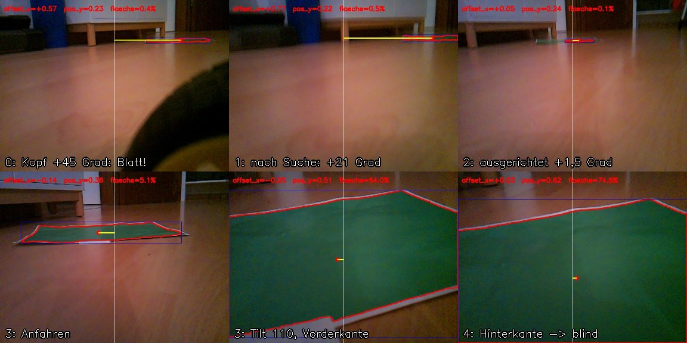

# Übung 7: Die ganze Mission – umschauen, suchen, ausrichten, hinfahren, parken

**Skript:** [`pi/mission_exercise_1.py`](../../pi/mission_exercise_1.py)
**Dauer:** ca. 45–60 Minuten
**Bewegt sich:** **ja**, das Auto dreht sich, fährt bis zu ~2 m und parkt
**Voraussetzung:** [Übung 5](align_exercise_1.md) (Ausrichten), [Übung 6](park_exercise_1.md) (Parken), Kalibrierung aus [Übung 5b](calibration_exercise_1.md)

> **Status:** Getestet am 2026-11-22, 2 von 2 Läufen erfolgreich. Damit ist **Stufe 1 des Projekts erreicht**.

> **Teil A – Lecture:** Theorie und Erklärungen, zum Vortragen oder Selbstlesen.  
> **Teil B – Exercise:** Praxis am Auto, Aufgaben und Lösungen zum Aufklappen.

## Lernziele

- Einzelne Bausteine zu **einem** Programm zusammensetzen (Funktionen statt Kopien)
- Ein **günstiger Sensor zuerst**: erst den Kopf schwenken, dann das ganze Auto drehen
- Eine Mission in **Phasen** zerlegen und jede Phase einzeln testbar halten
- Bewerten, wo die verbleibenden Fehler herkommen

---

## Teil A – Lecture

### Die Aufgabe

Das Auto steht irgendwo, **falsch ausgerichtet**, das grüne Blatt liegt 1–2 m entfernt. Ohne Hilfe soll es das Blatt finden, hinfahren und mittig darauf parken. Das ist genau das Ziel von **Stufe 1** des Projekts.

### Die Phasen

| Phase | Was passiert | Baustein |
|---|---|---|
| **0 UMSCHAUEN** | Nur der Kamerakopf schwenkt (0°, ±25°, ±45°). Ist das Blatt zu sehen, steht die Drehrichtung fest. | **neu**: `look_around()` |
| **1 SUCHEN** | Auf der Stelle in Impulsen drehen, bis das Blatt im Bild ist | Übung 5: `align()` |
| **2 AUSRICHTEN** | Drehen, bis das Blatt höchstens 4° neben der Mitte liegt | Übung 5: `align()` |
| **3 ANFAHREN** | In Impulsen vorwärts, unterwegs die Richtung korrigieren, Kamera rechtzeitig senken | Übung 6: `park()` |
| **4 PARKEN** | Abstand zur Hinterkante messen, Rest blind fahren | Übung 6: `park()` |

### Bausteine wiederverwenden statt kopieren

Übung 5 und 6 waren zunächst eigenständige Skripte, die jeweils selbst Kamera, Motoren und Servos öffnen. Für die Mission wurden sie in **Funktionen** zerlegt, die die Hardware als Parameter bekommen:

```python
cam = open_camera()
angle = look_around(cam, servo)                        # Phase 0
align(cam, motor, "rechts" if angle > 0 else "links")   # Phase 1 + 2
park(cam, motor, servo, open_sonar())                   # Phase 3 + 4
```

Die Einzelskripte funktionieren weiter wie bisher. Ihr `main()` ruft jetzt dieselben Funktionen auf. Jede Verbesserung (z. B. ein Filter gegen Reflexe) wirkt so sofort in beiden Übungen **und** in der Mission.

### Phase 0: Umschauen mit dem Kopf

Bei einem Test aus 150 cm lag das Blatt **links**, das Programm suchte aber stur **rechts** und drehte sich fast einmal im Kreis. Das Drehen des ganzen Autos ist langsam und ungenau (Übung 4). Den Kopf zu schwenken kostet dagegen fast nichts:

```python
SCAN_DEG = [0, -25, 25, -45, 45]          # Blickrichtung, + = rechts

def pan_for(deg):
    return round(PAN_CENTER - deg / 0.85)   # rechts = kleinere Pan-Werte (kalibriert)
```

Für jede Kopfstellung wird ein Bild ausgewertet. Der Winkel des Blattes relativ zur Fahrtrichtung ist dann:

```
Winkel = Kopfwinkel + offset_to_angle(offset_x)
```

Mit ±27° Bildwinkel und Kopfstellungen bis ±45° sieht das Auto etwa **±72°**, ohne sich zu bewegen. Liegt das Blatt weiter hinten, sucht es wie in Übung 5 nach rechts.

> **Prinzip:** Erst den günstigen Sensor bewegen, dann den teuren. Menschen machen das genauso: erst die Augen, dann den Kopf, dann den ganzen Körper.

**Grenze:** Die Pan-Kalibrierung gilt nur im Bereich 65–85 (etwa ±15°). Bei ±25° und ±45° ist die Umrechnung ungenau. Das zeigte sich im Test: Ein Blatt bei ~+43° war im Bild für den +25°-Kopf zu sehen, im Bild für den +45°-Kopf aber nicht. Für die **Richtung** reicht die Genauigkeit trotzdem. Den genauen Winkel misst danach Phase 2.

### Ergebnisse (2026-11-22, abends bei Kunstlicht)

| Lauf | Start | Phase 0 | Phase 1+2 | Phase 3+4 | Dauer |
|---|---|---|---|---|---|
| 1 | ~150 cm, verdreht | Blatt bei +42° (Kopf +25°) → rechts | 1 Suchimpuls, 3 Ausrichtschritte, ein Reflex verworfen, einmal „kurz verloren“ → **+1,8°** | 13 Impulse, Hinterkante 21,6 cm → 18,9 cm blind | **24 s** ✅ |
| 2 | ~150 cm, stärker verdreht | Blatt bei +61° (Kopf +45°) → rechts | 4 Suchimpulse, **5 Reflexe verworfen**, 6 Ausrichtschritte → **+1,5°** | 9 Impulse, Hinterkante 25,5 cm → 22,8 cm blind | **23 s** ✅ |


*Lauf 2. 0: Erst der Kopfschwenk auf +45° findet das Blatt (unten rechts ragt der eigene Reifen ins Bild). 1: Nach vier Suchimpulsen ist es im normalen Blickfeld (+21°). 2: ausgerichtet. 3: beim Anfahren und nach dem Absenken auf Tilt 110, die Vorderkante ist noch sichtbar. 4: Die Vorderkante erreicht den unteren Bildrand, aus der Hinterkante wird die Blindstrecke berechnet.*

Zum Lauf 2 gibt es auch eine Videoaufnahme.

**Beobachtungen:**
- Die Mission lief zweimal hintereinander ohne Eingriff durch. Die Robustheits-Maßnahmen aus Übung 5 und 6 (zweites Foto, Form- und Horizont-Filter, Wartezeit nach Bewegungen) haben dabei mehrfach gegriffen.
- In Lauf 1 kam der Wechsel auf Tilt 110 erneut knapp, weil `pos_y` in einem Impuls von 0,58 auf 0,78 sprang. Die Messung über die Hinterkante hat das aufgefangen.
- **Akku-Messung:** Vor einem Start meldete der ADC einmal 6,60 V und die Mission brach ab. Direkt danach lagen fünf Messungen bei 6,99–7,14 V. Seitdem wird der **Median aus 5 Messungen** verwendet.

### Woher die restlichen Zentimeter kommen

| Fehlerquelle | Größenordnung | Verbesserung |
|---|---|---|
| Bodenmodell bei 20–30 cm (kalibriert nur bis 22 cm) | einige cm | Messpunkte bei 25 und 30 cm ergänzen |
| Anfahrverzug und Geschwindigkeit hängen vom Akku ab | ~1 cm pro 0,1 V | Akkuspannung in die Rechnung einbeziehen |
| Reifen rutschen auf Papier anders als auf Laminat | unbekannt | mehrere Läufe, Mittelwert bilden |
| Wackliger Kamerakopf verschiebt den Horizont | 1–3 cm | Kabel mit Zugentlastung, Kopf fixieren |

---

## Teil B – Exercise

### Sicherheit

- Das Auto **dreht sich und fährt bis zu ~2 m**. Der Bereich um das Auto und der Weg zum Blatt müssen frei sein.
- Das Blatt mit Klebeband auf dem Boden **fixieren**.
- Akku vorher prüfen: unter 6,8 V startet die Mission nicht. Die Blindfahrt ist bei ~7,0–7,3 V kalibriert.
- Ultraschall-Not-Stopp bei < 15 cm, Motoren werden im `finally` immer gestoppt.

### Ausprobieren

```
python3 mission_exercise_1.py 0             # Trockenlauf: nur umschauen, Motoren aus
python3 mission_exercise_1.py               # die ganze Mission (Drehen 2000, Fahren 1500)
python3 mission_exercise_1.py 2000 1500     # dasselbe, Geschwindigkeiten explizit
```

Debug-Bilder in `~/smartcar/debug/`: `mission_scan_<grad>.jpg`, `mission_align_<n>.jpg`, `mission_park_<n>.jpg`.

### Aufgaben

1. **Trockenlauf:** Das Auto so hinstellen, dass das Blatt ~40° rechts liegt. Was meldet der Kopfschwenk? Stimmt die Richtung?
2. **Hinter dem Auto:** Das Blatt hinter das Auto legen (außerhalb von ±72°). Was passiert in Phase 0? Wie lange dauert die Mission jetzt?
3. **Wiederholgenauigkeit:** Fünf Läufe vom selben Startpunkt. Abweichung längs und quer jeweils messen. Wie groß ist die Streuung?
4. **Phase 0 genauer:** Den Kopfschwenk feiner machen (z. B. alle 15°). Lohnt sich das? Was kostet es an Zeit?
5. **Direkt hindrehen:** Phase 0 kennt den Winkel schon ungefähr. Statt in 15°-Schritten zu suchen, gleich mit [Übung 4](turn_exercise_1.md) um diesen Winkel drehen. Schneller? Genauer?
6. **Bonus:** Das Auto soll nach dem Parken eine Lichtshow mit den LEDs zeigen (Achtung: LED-Bibliothek braucht `sudo`).
7. **Bonus (Stufe 2?):** Zwei Blätter, zuerst zum näheren, dann zum zweiten fahren.

### Lösungen und Erfahrungswerte (für dieses Auto gemessen)

<details>
<summary>Aufklappen</summary>

1. **Trockenlauf:** Gemessen: „Kopf +25°: Blatt bei +43,1°“ → rechts. Richtig. Der genaue Wert ist wegen der Pan-Kalibrierung nur grob.
2. **Hinter dem Auto:** „Blatt nicht im Blickfeld (±72°)“ → Suche nach rechts. Liegt es links hinten, dreht das Auto bis zu ~290°. Bei ~15° pro Impuls und ~2 s pro Schritt dauert das eine knappe Minute.
3. **Wiederholgenauigkeit:** Bisher gemessen: Abweichungen längs von −6 bis +4 cm über alle Parkläufe. Für eine echte Aussage braucht es mehr Läufe mit gleichem Akkustand.
4. **Feiner schwenken:** Kaum Nutzen. Das Bild deckt schon ±27° ab, zwei Kopfstellungen 25° auseinander überlappen sich. Jede Stellung kostet ~0,7 s.
5. **Direkt hindrehen:** Spart Suchschritte. Die Odometrie aus Übung 4 ist aber nur auf ±5° genau, und der Winkel aus Phase 0 außerhalb ±15° auch nur grob. Danach muss trotzdem Phase 2 nachregeln.

</details>

---

## Ausblick

- **Übung 4b:** kontinuierlich drehen statt Stop-and-Go, macht die Suche schneller und ruhiger.
- **Genauigkeit:** Bodenmodell für größere Abstände, Akkuspannung in die Fahrzeit einbeziehen.
- **Stufe 2:** mehrere Ziele, Hindernisse, Ziele in anderen Farben.
