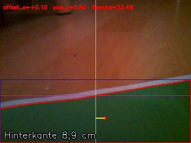
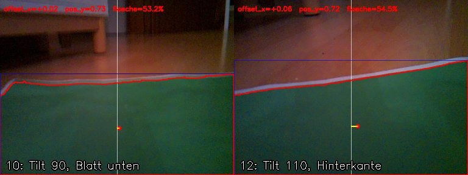
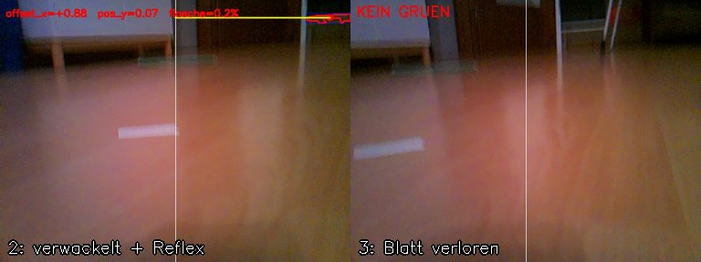
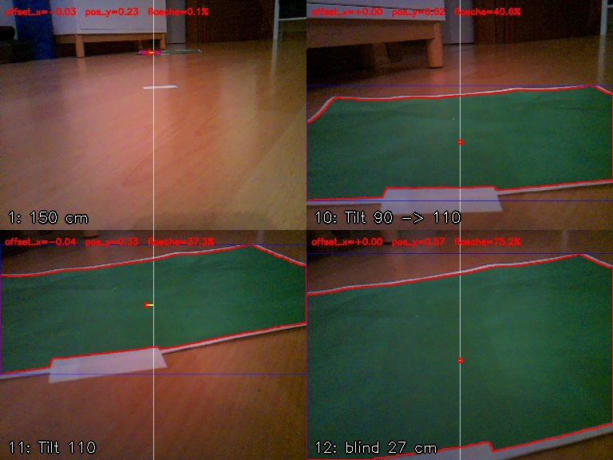

# Übung 6: Hinfahren und auf dem Blatt parken

**Skript:** [`pi/park_exercise_1.py`](../../pi/park_exercise_1.py)
**Dauer:** ca. 60–90 Minuten (inkl. Kalibrierung)
**Bewegt sich:** **ja**, das Auto fährt vorwärts und korrigiert die Richtung
**Voraussetzung:** [Übung 3](drive_exercise_1.md) (Fahren), [Übung 5](align_exercise_1.md) (Ausrichten)

> **Status:** Getestet am 2026-11-22 aus 100 cm und 150 cm. Das Auto steht auf dem Blatt, die Automitte liegt **4–6 cm** neben der Blattmitte (längs).

> **Teil A – Lecture:** Theorie und Erklärungen, zum Vortragen oder Selbstlesen.  
> **Teil B – Exercise:** Praxis am Auto, Aufgaben und Lösungen zum Aufklappen.

## Lernziele

- Ein **Zustandsautomat** mit mehreren Phasen
- Warum eine Kamera einen **toten Winkel** hat und wie man ihn überbrückt
- **Kalibrieren:** Messwerte aus der echten Welt in Programmkonstanten übersetzen
- **Koppelnavigation** (Dead Reckoning): die letzten Zentimeter ohne Sicht fahren
- Einen **Bezugspunkt** wählen, der möglichst lange sichtbar bleibt
- Fehler systematisch finden: ein **Vorzeichenfehler** und ein **Anfahrverzug**

---

## Teil A – Lecture

### Das Problem

Das Auto ist auf das Blatt ausgerichtet (Übung 5). Jetzt soll es hinfahren und **mittig auf dem Blatt** anhalten.

Die Schwierigkeit: **Kurz bevor das Auto auf dem Blatt steht, sieht die Kamera das Blatt nicht mehr.** Die Kamera schaut schräg nach vorne. Direkt vor und unter dem Auto liegt ein Bereich, den sie nicht erfassen kann, der **tote Winkel**.

```
   Kamera
     ◉ ╲
     │   ╲   Sichtbereich bei Tilt 110
     │     ╲
  ═══╪═══════╲════════════════   Boden
     │◀─────▶│
     toter Winkel (nicht sichtbar)
```

### Die Phasen (Zustandsautomat)

| Zustand | Was passiert | Übergang |
|---|---|---|
| **ANFAHREN (fern)** | Kamera auf Tilt 90. Vorwärtsimpulse von 0,4 s. Nach jedem Impuls Blatt suchen, bei > 5° Abweichung Richtung korrigieren. | `pos_y > 0,6` **oder** Blatt stößt unten an → Kamera senken |
| **ANFAHREN (nah)** | Kamera auf Tilt 110, kürzere Impulse (0,2 s) | Vordere Blattkante berührt den unteren Bildrand → EINPARKEN |
| **EINPARKEN** | Abstand zur **hinteren** Blattkante messen, restliche Strecke **blind** fahren (Koppelnavigation) | → FERTIG |

Sicherheitsnetz: Der Ultraschall stoppt bei einem Hindernis < 15 cm. Verliert das Programm das Blatt aus dem Blick, fotografiert es bis zu zweimal neu und bricht dann ab.

### Die blinde Reststrecke

Sobald die vordere Blattkante unten aus dem Bild verschwindet, ist sie genau **`TOTER_WINKEL_CM`** von der Kamera entfernt. Bis die **Mitte des Autos** über der **Mitte des Blattes** steht, fehlen noch:

```
rest_cm = TOTER_WINKEL_CM + BLATT_LAENGE_CM / 2 + KAMERA_VOR_MITTE_CM
rest_s  = rest_cm / SPEED_CM_PER_S + ANFAHR_VERZUG_S
```

Die Kamera sitzt **vor** der Automitte. Die Automitte ist also noch weiter vom Blatt entfernt als die Kamera und muss die 7,75 cm **zusätzlich** fahren. Im ersten Entwurf stand hier ein **Minus**. Dieser Vorzeichenfehler ist erst beim Testen aufgefallen (siehe Ergebnisse).

```
                   Kamera   Mitte Auto
                     ◉──────────●
  Boden  ───────────[══════ grünes Blatt ══════]──────
                     │◀ toter ▶│◀ Blatt/2 ▶│
                       Winkel
         Die Automitte muss bis zur Blattmitte: toter Winkel + Blatt/2 + (Kamera vor Mitte)
```

Für diese Rechnung braucht man drei **Kalibrierwerte**, die man nur am echten Auto messen kann:

| Wert | Bedeutung | Kalibriert |
|---|---|---|
| `SPEED_CM_PER_S` | Fahrgeschwindigkeit bei Speed 1500 | **50 cm/s** (1 s gefahren, ~50 cm) |
| `TOTER_WINKEL_CM` | Bodenabstand Linse → unterer Bildrand bei Tilt 110 | **5,4 cm** (= 3,7 cm ab Autokante) |
| `KAMERA_VOR_MITTE_CM` | Wie weit die Linse vor der Automitte sitzt | **7,75 cm** (Auto 19 cm lang, Linse 1,75 cm hinter der Kante) |
| `BLATT_LAENGE_CM` | Blattlänge in Fahrtrichtung | **21 cm** (A4 quer) |
| `ANFAHR_VERZUG_S` | Zeit, die beim Anfahren verloren geht | **0,12 s** (aus zwei Parkläufen, siehe unten) |

Wie diese Werte gemessen wurden, mit allen Umwegen und Fehlschlägen, steht in **[Übung 5b: Kalibrieren](calibration_exercise_1.md)**.

```
rest = 5,4 + 21/2 + 7,75 = 23,65 cm   →   23,65 / 50 + 0,12 = 0,59 s blind fahren
```

### Besser: die hintere Blattkante als Bezugspunkt

Die Formel oben hat eine Schwäche. Sie gilt nur, wenn die vordere Blattkante **genau in diesem Moment** am unteren Bildrand verschwindet. Das Auto fährt aber in Impulsen von 10–20 cm. Wenn die Kante schon ein Stück weiter ist, stimmt die Rechnung nicht mehr.

Die **hintere** Blattkante ist zu diesem Zeitpunkt noch gut im Bild. Mit dem Bodenmodell aus [Übung 5b](calibration_exercise_1.md) lässt sich ihr Abstand aus der Bildzeile berechnen:

```
d_hinten = h / tan(α + atan((y − 240) / f))        h = 5,2 cm, α = 23°, f = 634 px
rest_cm  = d_hinten − BLATT_LAENGE_CM / 2 + KAMERA_VOR_MITTE_CM
```


*Die Auswertung sucht in der Bildmitte die oberste grüne Zeile (violette Linie). Hier: y = 320 → 8,9 cm vor der Linse. Das Auto steht schon auf dem Blatt, nur die Mitte fehlt noch.*

Damit ist egal, wann genau der Übergang kommt. Die Formel über den toten Winkel bleibt als Rückfallebene, falls die Hinterkante nicht messbar ist.

### Warum die Geschwindigkeit das schwächste Glied ist

Die blinde Strecke ist **Koppelnavigation**: Zeit × Geschwindigkeit. Wie in Übung 4 gilt auch hier, dass die Mechanik nicht exakt tut, was man befiehlt:
- **Anfahren:** Das Auto braucht einen Moment, bis es auf Geschwindigkeit ist, und rollt nach dem Abschalten noch etwas nach.
- **Akkustand:** Mit sinkender Spannung fährt das Auto langsamer.
- **Untergrund:** Auf dem Papier haben die Reifen anders Grip als auf dem Laminat.

Gemessen wurde der **Anfahrverzug**: Bei 1 s Fahrt fällt er kaum auf (~50 cm), bei kurzen Impulsen dagegen deutlich. Zwei Parkläufe passen zu einem einfachen Modell „die ersten **0,12 s** zählen nicht“:

| geplant | Dauer | tatsächlich gefahren |
|---|---|---|
| 8,2 cm | 0,16 s | ~2 cm (es fehlten ~8 cm) |
| 21,6 cm | 0,43 s | ~15,6 cm (es fehlten ~6 cm) |

Mit `rest_s = rest_cm / 50 + 0,12` stimmen beide Läufe.

Je **kürzer** die blinde Strecke, desto kleiner der Fehler. Deshalb wird die Kamera im Nahbereich auf Tilt 110 gesenkt: Der tote Winkel wird kleiner.

### Hardware-Hinweis: wackliger Kamerakopf

Der Kamerakopf kann durch verrutschte Kabel verkippen oder verdrehen (siehe [Übung 5](align_exercise_1.md)). Für diese Übung ist das besonders kritisch:
- Ein **verdrehter** Kopf lässt das Auto schräg auf das Blatt zufahren.
- Ein **verkippter** Kopf verschiebt den unteren Bildrand und verändert damit den **toten Winkel**, also genau den Wert, mit dem die blinde Reststrecke berechnet wird.

→ Vor dem Parken kurz die Pan-Kalibrierung prüfen und den toten Winkel nur bei **geradem** Bild messen.

### Ergebnisse (2026-11-22, abends bei Kunstlicht)

| Lauf | Start | Was passierte | Ergebnis |
|---|---|---|---|
| 1 | 100 cm | Wechsel auf Tilt 110 einen Impuls zu spät; Formel mit **Vorzeichenfehler** (8,2 cm statt ~10,5 cm) | auf dem Blatt, **~8 cm zu kurz** |
| 2 | 100 cm | neue Logik (Hinterkante 24,4 cm → 21,6 cm blind), aber noch ohne Anfahrverzug | auf dem Blatt, **~6 cm zu kurz** |
| 3 | 150 cm | Bild verwackelt, Lichtreflex oben im Bild als Blatt genommen → 24° falsch gedreht | **Abbruch** |
| 4 | 150 cm | mit Horizont-Filter, Wartezeit, Anfahrverzug: Hinterkante 30,1 cm → 27,4 cm blind | auf dem Blatt, **~4 cm zu weit** ✅ |
| 5, 6 | Kombi-Übung 7 | siehe [Übung 7](mission_exercise_1.md) | ✅ |

**Lauf 1: der Wechsel kam zu spät**


*Links: Bei Tilt 90 reicht das Blatt schon bis an den unteren Bildrand, `pos_y` war aber nur 0,73 (Schwelle 0,75). Das Auto fuhr noch einen ganzen Impuls. Rechts: Nach dem Absenken ist die sichtbare Kante bereits die **hintere**.*

Daraus folgte: früher umschalten (`pos_y > 0,6` oder Blatt stößt unten an), im Nahbereich kürzere Impulse, und die Reststrecke über die Hinterkante berechnen.

**Lauf 3: verwackelt und getäuscht**


*Links: Das Foto nach dem Fahrimpuls ist verwackelt, das Blatt (Mitte) wird nicht erkannt. Stattdessen wird ein Reflex am oberen Bildrand (rechts oben) genommen. Rechts: Nach der Drehung zum vermeintlichen Blatt ist das echte verloren.*

Korrekturen: der Horizont- und Formfilter aus Übung 5 auch hier, nach jedem Impuls 0,8 s warten und ein Bild verwerfen, bei „kein Blatt“ bis zu zweimal neu fotografieren.

**Lauf 4: Erfolg aus 150 cm**


*1: Start in 150 cm. 10: Das Blatt nähert sich dem unteren Bildrand, Wechsel auf Tilt 110. 11: Bei Tilt 110 ist die Vorderkante wieder sichtbar. 12: Vorderkante am Bildrand, die Hinterkante liegt 30,1 cm vor der Linse → 27,4 cm blind.*

**Beobachtungen:**
- Ein Fehler von 4–6 cm ist für ein 19 cm langes Auto auf einem 21 cm langen Blatt gut: Das Auto steht in allen erfolgreichen Läufen **auf** dem Blatt.
- Der größte Unsicherheitsfaktor ist jetzt das **Bodenmodell bei großer Entfernung**: Es ist mit Punkten bis 22 cm kalibriert. Die Hinterkante lag bei 21–30 cm, also teils außerhalb.
- Das Auto driftet beim Geradeausfahren leicht nach links, die Richtungskorrektur unterwegs fängt das ab.

---

## Teil B – Exercise

### Sicherheit

- Das Auto **fährt vorwärts**. Vorher klären, ob der Weg zum Blatt frei ist.
- Ultraschall-Not-Stopp bei < 15 cm, maximal 60 Schritte.
- Ohne Kalibrierwerte verweigert das Skript den Start. Die Werte sind seit 2026-11-22 eingetragen.

### Kalibrieren

```
python3 park_exercise_1.py kalibrieren
```
Das Skript stellt die Kamera auf Tilt 110 und speichert `~/smartcar/debug/park_kalibrierung_tilt110.jpg`. Ein Maßband längs vor das Auto legen und ablesen, welcher Abstand gerade noch am unteren Bildrand sichtbar ist. Die drei Werte oben im Skript eintragen.

### Ausprobieren

```
python3 align_exercise_1.py rechts 2000    # erst ausrichten (Übung 5)
python3 park_exercise_1.py 1500            # dann hinfahren und parken
```

Debug-Bilder: `~/smartcar/debug/park_<schritt>.jpg`

### Aufgaben

1. **Kalibrieren:** Die Werte messen und eintragen. Wie groß ist der tote Winkel bei Tilt 110? Und bei Tilt 90?
2. **Erster Parkversuch:** Wie weit liegt die Automitte nach dem Parken neben der Blattmitte, längs und quer?
3. **Fehlerquelle finden:** Parkt das Auto zu früh oder zu spät? Welcher Kalibrierwert ist vermutlich falsch?
4. **Hochkant oder quer:** Das Blatt einmal längs (29,7 cm) und einmal quer (21 cm) zur Fahrtrichtung legen. Was muss im Skript angepasst werden?
5. **Weit weg:** Das Blatt 2 m entfernt hinlegen. Funktioniert die Erkennung aus der Ferne? Ab welcher Entfernung nicht mehr?
6. **Bonus:** Übung 5 und 6 zu **einem** Programm zusammenführen: suchen → ausrichten → anfahren → parken.
7. **Bonus:** Die Blattlänge **messen statt eintragen**: Solange Vorder- und Hinterkante im Bild sind, liefert das Bodenmodell beide Abstände. Wie lang ist das Blatt?
8. **Vorzeichen:** Die alte Formel `rest = toter Winkel + Blatt/2 − Kamera vor Mitte` mit einer Skizze überprüfen. Wo ist der Fehler?
9. **Anfahrverzug:** `ANFAHR_VERZUG_S` auf 0 setzen und parken. Wie weit fehlt es? Passt das zu 0,12 s × 50 cm/s?

### Lösungen

<details>
<summary>Aufklappen</summary>

1. **Toter Winkel:** Tilt 110: 5,4 cm ab Linse (3,7 cm ab Autokante). Tilt 90 ist deutlich größer, die Kamera schaut flacher.
2. **Erster Parkversuch:** 4–8 cm längs, je nach Stand der Korrekturen. Quer kaum Abweichung, die Richtungskorrektur unterwegs funktioniert.
3. **Fehlerquelle:** Zu früh (zu kurz) geparkt → Vorzeichenfehler und Anfahrverzug. Zu weit → Bodenmodell bei großer Entfernung oder zu später Wechsel ohne Hinterkanten-Messung.
4. **Hochkant:** `BLATT_LAENGE_CM = 29.7` setzen. Mit der Hinterkanten-Methode geht diese Länge direkt in die Reststrecke ein.
5. **Weit weg:** 150 cm funktioniert, bei Kunstlicht erst nach dem Senken der Sättigungsgrenze (Übung 2). Das Blatt ist dann ein 3–10 Pixel hoher Streifen.
6. **Zusammenführen:** Siehe [Übung 7](mission_exercise_1.md).
7. **Blattlänge:** Gegenprobe in Übung 5b: Vorderkante 5,2 cm, Hinterkante 24,4 cm → ~19 cm. A4 quer: 21 cm.
8. **Vorzeichen:** Die Kamera liegt **vor** der Automitte. Wenn das Blatt d cm vor der Kamera liegt, liegt es d + 7,75 cm vor der Automitte. Also Plus.
9. **Anfahrverzug 0:** Es fehlen ~6 cm. 0,12 s × 50 cm/s = 6 cm, passt.

</details>
