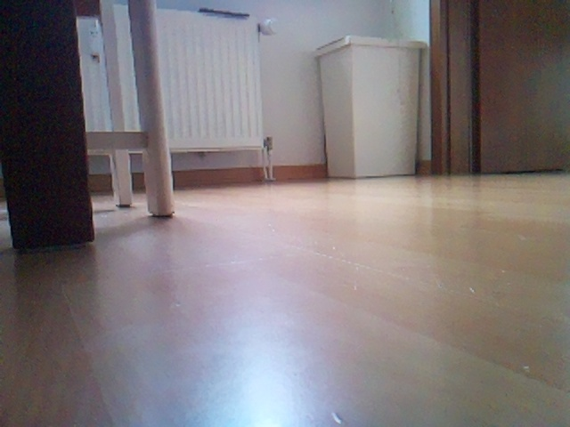
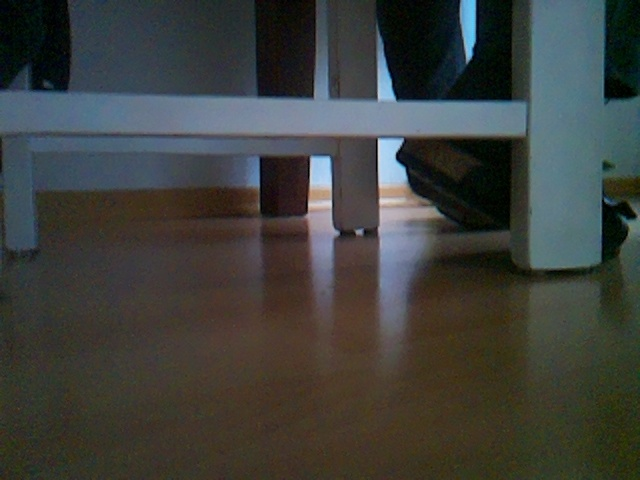
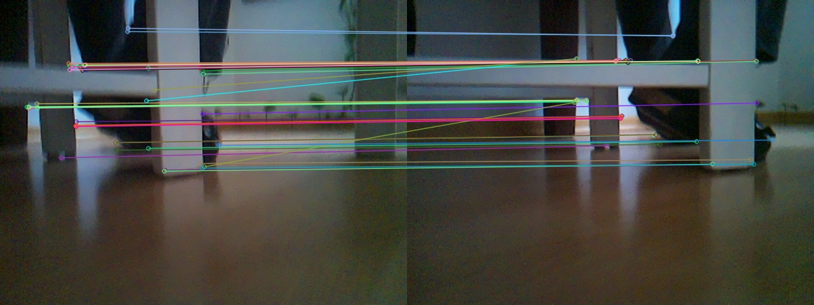
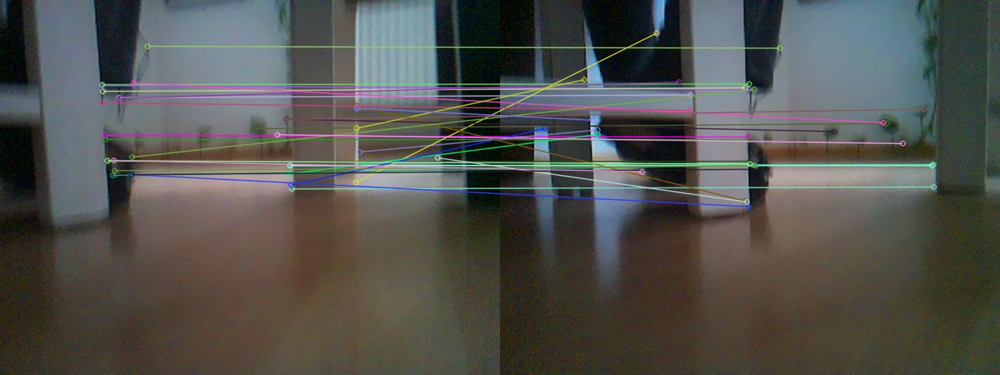
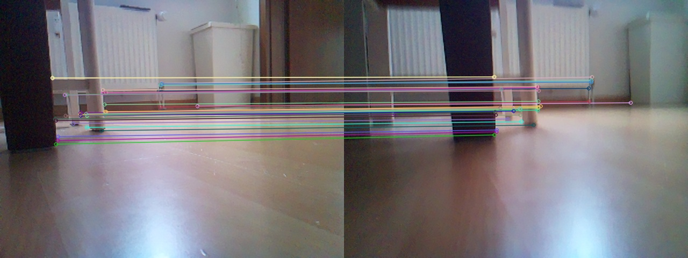
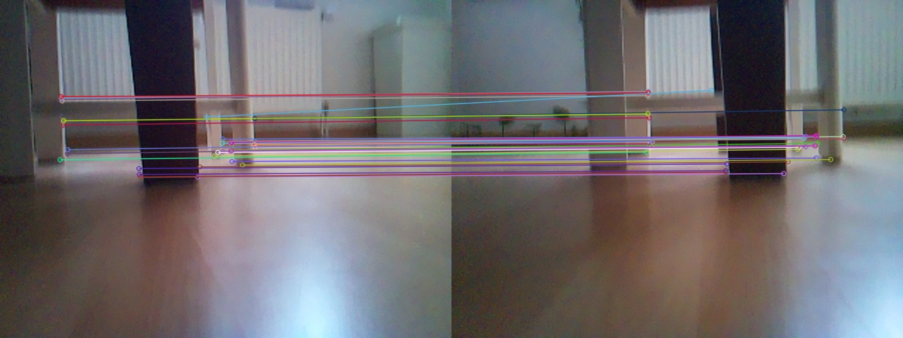
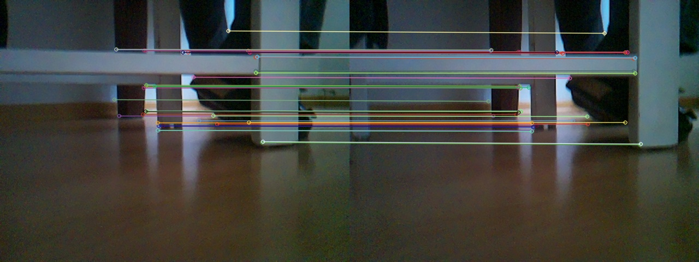

# Übung 4: Um 90° drehen – ohne Gyroskop

**Skript:** [`pi/turn_exercise_1.py`](../../pi/turn_exercise_1.py)
**Dauer:** ca. 60–90 Minuten
**Bewegt sich:** **ja**, das Auto dreht sich auf der Stelle
**Voraussetzung:** [Übung 2](cv_exercise_1.md) (Bildverarbeitung) und [Übung 3](drive_exercise_1.md) (Motoren)

> **Teil A – Lecture:** Theorie und Erklärungen, zum Vortragen oder Selbstlesen.  
> **Teil B – Exercise:** Praxis am Auto, Aufgaben und Lösungen zum Aufklappen.

## Lernziele

- Markante Punkte in Bildern finden und wiedererkennen (**ORB-Features**, **Matching**)
- Das **Lochkamera-Modell**: Pixel in Winkel umrechnen
- Warum eine **Drehung** viel einfacher zu messen ist als eine Vorwärtsfahrt
- Robuste Statistik: **Median** und **Ausreißer** verwerfen
- Ein einfacher **Regelkreis**: messen → Restwinkel → nächsten Impuls bemessen
- Warum Messfehler sich aufsummieren (**Drift**)
- Warum man bei schwieriger Hardware **schrittweise** (Stop-and-Go) arbeitet

---

## Teil A – Lecture

### Das Problem

Das Auto soll sich um genau 90° drehen. Dabei hat es **keinen Sensor, der Winkel misst**:
- Am I2C-Bus hängen nur der PWM-Baustein für Motoren und Servos (`0x40`) und der Analog-Digital-Wandler (`0x48`).
- Ein Gyroskop wie der MPU-6050 wäre bei `0x68` zu finden. Dort ist nichts.
- Die Räder haben auch keine Drehgeber (Encoder).

**Naheliegende Idee:** „Bei Speed 2000 dreht das Auto X Grad pro Sekunde, also einfach 90/X Sekunden drehen.“ Das klappt nur mäßig:
- Beim Drehen auf der Stelle **rutschen** die Räder seitlich über den Boden (Skid-Steering).
- Wie viel sie rutschen, hängt vom **Untergrund**, vom **Akkustand** und vom **Anfahrruck** ab.

**Die Lösung dieser Übung:** Die **Kamera** misst, wie weit sich das Auto gedreht hat. Das nennt man **visuelle Odometrie**.

### Warum Drehen mit einem 4WD-Auto schwierig ist

Das SmartCar hat **vier feste Räder ohne Lenkung**. Zum Drehen auf der Stelle laufen die linken Räder rückwärts und die rechten vorwärts (bzw. umgekehrt). Das nennt man **Skid-Steering**, wie bei einem Panzer oder Bagger.

```
      vorne
   ◀══╗   ╔══▶      Die Räder wollen nur in Fahrtrichtung des Autos rollen,
      ║ ⟲ ║         beim Drehen bewegen sie sich aber auf einem Kreis um die
   ◀══╝   ╚══▶      Mitte. Die Querbewegung geht nur, indem sie seitlich
      hinten        über den Boden RUTSCHEN (radieren).
```

Daraus folgen mehrere Probleme:
- **Rutschen ist unberechenbar.** Wie leicht die Räder seitlich rutschen, hängt vom **Untergrund** (Laminat, Teppich, Fliesen), von **Staub**, vom **Gummi** und von der **Gewichtsverteilung** ab. Dieselbe Motorzeit ergibt auf Teppich einen ganz anderen Winkel als auf Laminat.
- **Hohe Losbrechkraft.** Bevor die Räder rutschen, muss die Haftreibung überwunden werden. Deshalb braucht Drehen deutlich mehr Leistung (hier Speed 2000) als Geradeausfahren (1500), und das Anfahren ist ruckartig. Sehr kurze Impulse bewegen das Auto fast gar nicht.
- **Kein fester Drehpunkt.** Haben die Räder links und rechts unterschiedlich viel Grip, dreht das Auto nicht exakt um seine Mitte, sondern **wandert** dabei etwas.
- **Akkustand.** Mit sinkender Spannung sinkt die Kraft, und die Drehrate ändert sich.
- **Nachlaufen.** Nach dem Abschalten dreht das Auto durch die Trägheit noch ein kleines Stück weiter.

#### Die Reifen dieses Autos

Die Reifen des Freenove-Kits sind **nicht ideal** für das Drehen auf der Stelle. Das harte Gummi mit Profil greift ungleichmäßig, und auf glattem Laminat wechseln sich Haften und Rutschen ab. In unseren Testläufen zeigte sich das deutlich:

- Die Drehrate schwankte zwischen **42 und 62°/s**, bei immer gleichem Motorbefehl (Speed 2000, Impuls 0,3 s).
- Pro Impuls drehte das Auto mal **19°**, mal nur **11°**, je nachdem, in welche Richtung es gerade stand. Laminatfugen, Staub und die Lage zur Fuge spielen hier hinein.
- Gleiches Programm, gleiche Startposition, und trotzdem jedes Mal eine andere Abfolge von Teilschritten.

**Das ist keine Schwäche der Software, sondern eine Eigenschaft der Hardware.** Gute Robotik-Software geht genau davon aus: Die Mechanik tut nie exakt, was man befiehlt, deshalb wird gemessen und nachgeregelt.

 Ein Fahrzeug mit **zwei angetriebenen Rädern und einem Stützrad** (Differentialantrieb, wie bei Saugrobotern) oder mit **Mecanum-Rädern** dreht viel sauberer, weil dort kaum etwas radieren muss.

→ Genau deshalb reicht es nicht, „einfach X Sekunden zu drehen“. Man muss **messen**, wie weit sich das Auto wirklich gedreht hat.

### Die Grundidee

Dreht sich das Auto nach **links**, wandert die ganze Welt im Kamerabild nach **rechts**. Wenn man weiß, wie viele Grad ein Pixel entspricht, kann man aus der Verschiebung den Drehwinkel ausrechnen.

**Vorher und nachher (87° nach links gedreht):**

| Start | Ende |
|---|---|
|  |  |

Am Anfang schaut die Kamera auf Heizung, Mülleimer und Tür. Nach der Drehung schaut sie auf die weiße Bank, die vorher ganz links am Bildrand war.

### Schritt 1: Markante Punkte finden (ORB)

Das Programm weiß nicht, was ein „Tischbein“ ist. Stattdessen sucht **ORB** (*Oriented FAST and Rotated BRIEF*) automatisch nach **Ecken**:

- **Finden (FAST):** Für jedes Pixel wird ein Kreis aus 16 Nachbarpixeln geprüft. Ist ein großer zusammenhängender Teil des Kreises deutlich heller oder dunkler als die Mitte, ist das eine Ecke. Beispiele: Tischbein trifft Tischplatte, Steckdose, Fußleiste.
- **Beschreiben (BRIEF):** Um jede Ecke herum werden 256 Pixelpaare verglichen: Ist Pixel A heller als Pixel B? Das ergibt einen **256-Bit-Fingerabdruck** pro Punkt, z. B. `1011001110…`.

```python
orb = cv2.ORB_create(nfeatures=1500)
keypoints, descriptors = orb.detectAndCompute(graubild, None)
```

> Eine **weiße Wand** hat keine Ecken, und damit gibt es dort keine Punkte und keine Messung.

Gesucht wird nur in den **oberen 55 % des Bildes** (Wände, Möbel, Türen). Der Boden direkt vor dem Auto wird per Maske ausgeblendet, denn er ist sehr nah und spiegelt:
```python
roi = np.zeros_like(graubild)
roi[: int(480 * 0.55), :] = 255          # weiß = hier suchen
keypoints, descriptors = orb.detectAndCompute(graubild, roi)
```

### Schritt 2: Punkte zuordnen (Matching)

Für jeden Fingerabdruck aus Bild A wird der ähnlichste in Bild B gesucht. Ähnlichkeit heißt hier **Hamming-Distanz**, also die Anzahl unterschiedlicher Bits. Das lässt sich extrem schnell berechnen.

```python
matcher = cv2.BFMatcher(cv2.NORM_HAMMING, crossCheck=True)
matches = matcher.match(descriptors_a, descriptors_b)
```

`crossCheck=True` heißt: Eine Zuordnung zählt nur, wenn sie **in beide Richtungen** gilt. A1 hält B7 für seinen besten Partner, **und** B7 hält A1 für seinen besten.

**So sieht das aus** (links vorher, rechts nachher, jede Linie = eine Zuordnung):


*Schritt 5, 19,1° gedreht, 89 gute Punkte. Die richtigen Zuordnungen verlaufen fast **parallel**: Alles ist um denselben Betrag nach rechts gewandert. Das Tischbein ist von x ≈ 270 auf x ≈ 470 gewandert.*


*Schritt 4, 15,7°, nur 19 gute Punkte. Hier sieht man viele **falsche Zuordnungen**, die Linien laufen kreuz und quer. Die weißen Tischbeine sehen sich alle ähnlich, und das verwirrt den Matcher. Deshalb braucht es Schritt 4.*

### Schritt 3: Pixel in Grad umrechnen (Lochkamera-Modell)

Ein Punkt, der um den Winkel α neben der Blickrichtung liegt, landet im Bild bei

```
x = f · tan(α)        →        α = atan(x / f)
```

- `x` = Abstand von der Bildmitte in Pixeln
- `f` = **Brennweite in Pixeln**. Sie ergibt sich aus dem horizontalen Bildwinkel der Kamera:

```
f = (Bildbreite / 2) / tan(Bildwinkel / 2) = 320 / tan(53,5° / 2) ≈ 634 Pixel
```

Für jeden zugeordneten Punkt:

```python
drehung = atan(x_nachher / f) - atan(x_vorher / f)
```

#### 💡 Der entscheidende Trick
Bei einer **reinen Drehung** verschieben sich **alle Punkte um denselben Winkel**, egal ob sie 50 cm oder 5 m entfernt sind.
Bei einer **Vorwärtsfahrt** wäre das anders: Nahe Dinge rasen durchs Bild, ferne bewegen sich kaum. Dafür bräuchte man die Entfernung jedes Punktes, und die kennt eine einzelne Kamera nicht.
→ **Drehungen kann man mit einer Kamera viel leichter messen als Strecken.**

### Schritt 4: Ausreißer rauswerfen (Median)

Aus z. B. 89 Punkten entstehen 89 Einzelmessungen. Die meisten sagen „19°“, ein paar Fehlzuordnungen sagen „3°“ oder „31°“.

1. Den **Median** nehmen, also den mittleren Wert der sortierten Liste. Anders als der Durchschnitt lässt er sich von einzelnen Ausreißern nicht verziehen.
2. Alle Messungen verwerfen, die zu weit vom Median abweichen. Die Toleranz beträgt 25 % des Medians, mindestens 2,5°, weil nahe Objekte durch Parallaxe etwas weiter wandern (siehe Ergebnisse).
3. Vom Rest noch einmal den Median nehmen. Das ist das Ergebnis.
4. Weniger als 15 gute Punkte übrig? Dann gilt die Messung als **fehlgeschlagen**.

### Schritt 5: Schrittweise arbeiten (Stop-and-Go)

> **Wichtig: Diese Übung arbeitet bewusst schrittweise.** Drehen, anhalten, messen, entscheiden, wieder drehen. Das ist langsamer als eine flüssige Drehung, aber bei dieser Hardware (rutschende Reifen, einfache Kamera, kein Gyro) **deutlich robuster und leichter zu verstehen**: Jeder Schritt lässt sich einzeln ansehen und nachvollziehen.

Das Auto dreht in kurzen **Impulsen** und hält dazwischen an:
- **Unschärfe:** Während der Drehung verschmiert das Bild, und die Ecken sind nicht mehr zu finden. Also: anhalten, 0,4 s warten, dann das Foto machen.
- **Überlappung:** Die Kamera sieht nur ~53° Breite. Dreht das Auto mehr als ~25–30° pro Schritt, haben die beiden Bilder zu wenig gemeinsam. Deshalb dauert ein Impuls **höchstens 0,3 s**, das sind ~18°.
- **Nicht überdrehen:** Aus den bisherigen Schritten kennt das Programm die **Drehrate** (°/s). Den nächsten Impuls bemisst es auf **80 % des Restwinkels**. Es landet lieber knapp darunter und macht noch einen kleinen Korrekturschritt.
- **Fehlmessung:** Schlägt eine Messung fehl, z. B. vor einer weißen Wand, wird der Winkel aus der Drehrate **geschätzt**. Erst nach 2 Fehlschlägen hintereinander bricht das Programm ab.

```
   ┌──────────────┐     ┌──────────┐     ┌──────────────┐     ┌──────────────────┐
   │ Foto A       │ ──▶ │ Impuls   │ ──▶ │ Foto B       │ ──▶ │ Winkel messen    │
   └──────────────┘     │ drehen   │     └──────────────┘     │ Summe += Winkel  │
          ▲             └──────────┘                          └────────┬─────────┘
          │                                                            │
          │          Rest > 3°: nächsten Impuls = 80 % Rest / Rate     │
          └────────────────────────────────────────────────────────────┘
                              Rest ≤ 3°: fertig
```

#### Die Alternative: kontinuierlich drehen und dauerhaft überwachen

Ideal wäre eine **flüssige Drehung**, bei der die Kamera **laufend** misst und das Auto genau im richtigen Moment stoppt. Das ist eine eigene, deutlich schwierigere Aufgabe (geplante Folgeübung):
- Die Kamera muss mit hoher Bildrate laufen (z. B. 30–60 fps), damit sich zwei aufeinanderfolgende Bilder nur um 1–2° unterscheiden.
- **Bewegungsunschärfe** muss beherrscht werden, z. B. durch kurze Belichtungszeit und gutes Licht.
- Die Auswertung muss **schneller als die Bildrate** sein. Auf dem Pi 4 reicht dafür ORB mit 1500 Punkten nicht, man braucht weniger Punkte oder **optischen Fluss** (`cv2.calcOpticalFlowPyrLK`).
- Man braucht einen **Regler**, der rechtzeitig abbremst. Wegen der Trägheit dreht das Auto nach dem Abschalten noch nach.
- Ein Messaussetzer darf nicht zum Überdrehen führen.

### Ergebnisse aus dem Testlauf

#### Echter Lauf (2026-11-22, Laminatboden, Akku 8,16 V)

| Schritt | Impuls | Gemessen | Punkte | Summe |
|---|---|---|---|---|
| 1 | 0,25 s | +14,7° | 78 | 14,7° |
| 2 | 0,30 s | +16,5° | 60 | 31,3° |
| 3 | 0,30 s | ~17,1° **geschätzt** | 3 | 48,4° |
| 4 | 0,30 s | +15,7° | 19 | 64,0° |
| 5 | 0,30 s | +19,1° | 89 | 83,1° |
| 6 | 0,09 s | +4,1° | 200 | **87,2°** |

|  |  |  |
|---|---|---|
| Schritt 1: +14,7°, 78 Punkte | Schritt 2: +16,5°, 60 Punkte | Schritt 6: Feinkorrektur +4,1°, 200 Punkte |

*Bei gut strukturierter Umgebung (Tisch- und Stuhlbeine) laufen die Zuordnungen schön parallel. Je kleiner die Drehung, desto mehr überlappen die Bilder und desto mehr Punkte passen zusammen.*

Drehrate bei Speed 2000: **~55–60°/s**. In Schritt 3 schaute die Kamera auf die weiße Heizung bzw. Wand, deshalb wurde geschätzt.

#### Weitere Läufe: Startposition mit Blick auf die Wand (2026-11-22)

| Lauf | Richtung | Software-Stand | Gemessen | Geschätzte Schritte | Real (nach Augenmaß) |
|---|---|---|---|---|---|
| A | links | Ausreißer-Toleranz ±2° | 91,4° | 3 von 7 | knapp unter 90° |
| B | rechts | Toleranz wächst mit dem Winkel | 87,8° | 2 von 6 | – |
| C | links | + nur obere Bildhälfte | 89,3° | 1 von 7 | – |

Pro Impuls wurden in Lauf C zwischen 11° und 19° gemessen (Drehrate 42–62°/s). Das sind die schwankenden Reifen, siehe oben.

#### Verbesserungen durch die Testläufe

1. **Kürzere Impulse** (max. 0,3 s statt 0,6 s): Die Bilder überlappen immer genug.
2. **Schätzen statt abbrechen:** Bei einem Messaussetzer wird der Winkel aus der bisherigen Drehrate geschätzt.
3. **Mitwachsende Toleranz** (25 % vom Median, mind. 2,5°): Die Kamera sitzt **vor** der Drehachse und wandert beim Drehen etwas seitlich. Nahe Objekte verschieben sich dadurch stärker als ferne (**Parallaxe**). Bei ~10 cm Abstand zur Achse, einem Objekt in 50 cm und 16° Drehung macht das ~3° aus.
4. **Nur die obere Bildhälfte nutzen** (Wände, Möbel, Türen): Der **Boden** direkt vor dem Auto ist sehr nah (maximale Parallaxe), und das Laminat **spiegelt**. Die Lichtreflexe wandern mit der Kamera statt mit dem Raum, ORB findet dort also „Ecken“, die bei jeder Drehung woanders liegen. Mit dieser Änderung sank die Zahl der geschätzten Schritte von 3 auf 1.

#### Erster Versuch: Was schiefging
Im ersten Versuch durfte ein Impuls bis zu 0,6 s dauern. Schritt 2 drehte 34,5°. Der nächste Impuls (~30°) ließ zu wenig Überlappung, und die Kamera schaute auf eine weiße Wand. Es blieben nur 5 Punkte, und das Programm brach ab, obwohl sich das Auto längst gedreht hatte. **Lösung:** Impulse auf 0,3 s begrenzen, die Kamera etwas höher richten (Tilt 80) und bei Fehlmessung schätzen statt abbrechen.

### Warum es nur „semi gut“ klappt

| Fehlerquelle | Wirkung |
|---|---|
| **Bildwinkel nur aus dem Datenblatt** (53,5°) | Ist er real anders, ist **jede** Messung um denselben Faktor falsch. |
| **Fehler summieren sich (Drift)** | Jeder Schritt hat ±0,5–1° Fehler, bei 6 Schritten addiert sich das. Das gilt für jede Odometrie, auch für Gyroskope. |
| **Kamera sitzt nicht auf der Drehachse** | Sie ist vorne am Auto und verschiebt sich beim Drehen etwas seitlich. Nahe Objekte wandern dann etwas weiter als ferne (Parallaxe). Die Messung fällt dadurch eher etwas **zu groß** aus. |
| **Spiegelnder Boden** | Reflexe auf dem Laminat wandern mit der Kamera und erzeugen falsche Punkte. Deshalb wird nur die obere Bildhälfte genutzt. |
| **Reifen / Untergrund** | Die Drehrate schwankt stark (42–62°/s). Die Messung fängt das ab, aber der letzte Impuls kann trotzdem etwas zu kurz oder zu lang ausfallen. |
| **Texturlose Flächen** | Weiße Wand oder Heizung: keine Ecken, keine Messung, nur Schätzung. |
| **Ähnliche Objekte** | Mehrere gleiche Tischbeine führen zu Fehlzuordnungen (siehe Schritt 4). |
| **Kamera leicht geneigt** | Die Formel gilt streng genommen nur für eine waagerechte Kamera. |

**Trotzdem bemerkenswert:** Ohne einen einzigen Winkelsensor landet das Auto mit wenigen Grad Abweichung bei 90°.

> In der Praxis, z. B. bei Mars-Rovern, Drohnen und Saugrobotern, kombiniert man genau dieses Verfahren mit einem Gyroskop. Das Gyro ist kurzfristig sehr genau, driftet aber langsam. Die Kamera driftet nicht, fällt aber manchmal aus. Zusammen (z. B. per Kalman-Filter) ergänzen sie sich.

---

## Teil B – Exercise

### Sicherheit

- Das Auto dreht sich **auf der Stelle** und braucht etwa seinen eigenen Umfang an Platz.
- Motoren werden im `finally` immer gestoppt, auch bei Ctrl+C oder `timeout`.
- Maximal 25 Schritte, danach bricht das Programm ab.

### Ausprobieren

```
python3 turn_exercise_1.py 90 links 0        # Trockenlauf: Motoren aus, Messung muss ~0° ergeben
python3 turn_exercise_1.py 90 links 2000     # echte 90° nach links
python3 turn_exercise_1.py 45 rechts 2000
```

Debug-Bilder in `~/smartcar/debug/`: `turn_start.jpg`, `turn_end.jpg`, `turn_matches_<schritt>.jpg`

### Aufgaben

1. **Trockenlauf:** Mit `speed=0` starten. Warum muss dabei ~0° herauskommen? Was würde es bedeuten, wenn nicht?
2. **Nachmessen:** Vor dem Start ein Blatt Papier oder Klebeband bündig an die Seite des Autos legen, dann 90° drehen. Mit einem Geodreieck messen: Wie viel hat es sich *wirklich* gedreht?
3. **Bildwinkel kalibrieren:** Wenn das Auto real z. B. 95° statt 87° gedreht hat, wie muss `HFOV_DEG` angepasst werden? *Tipp:* Bei kleinen Winkeln ist die gemessene Drehung ungefähr proportional zum Bildwinkel.
4. **Matches ansehen:** Die `turn_matches_*.jpg` aller Schritte vergleichen. Bei welchem Schritt gibt es die meisten Fehlzuordnungen? Woran liegt es?
5. **Impulslänge:** `MAX_PULSE_S` auf 0,6 setzen. Was passiert? Warum?
6. **Umgebung:** Das Auto vor eine kahle Wand stellen und drehen lassen. Wie oft wird geschätzt? Was kann man tun, z. B. ein Poster aufhängen oder die Kamera anders neigen?
7. **Naiver Ansatz zum Vergleich:** Ein eigenes Skript schreiben, das einfach `90 / 57` Sekunden lang dreht. Das fünfmal wiederholen und jedes Mal nachmessen. Streut das Ergebnis mehr oder weniger als mit Kamera?
8. **Bonus – 360°-Kalibrierung:** Das Auto einmal komplett herumdrehen. Wenn es wieder genau auf das Startbild schaut, muss die Summe 360° sein. Wie weit liegt die Messung daneben? Daraus lässt sich der echte Bildwinkel berechnen.
9. **Bonus – Boden ausblenden:** `ROI_TOP_FRACTION` auf 1.0 setzen, dann wird der Boden wieder mitgenutzt. Wie oft muss jetzt geschätzt werden? In den `turn_matches_*.jpg` nachsehen, wo die falschen Zuordnungen liegen.
10. **Ausblick – kontinuierlich drehen:** Wie müsste ein Programm aussehen, das *ohne anzuhalten* dreht und laufend misst? Welche Probleme kommen dazu? (Siehe Lecture, „Die Alternative“.)
11. **Bonus – Gyroskop:** Ein MPU-6050 (I2C, ein paar Euro) nachrüsten und die Drehung zusätzlich mit dem Gyro messen. Welcher Sensor ist genauer?

### Lösungen und Erfahrungswerte (für dieses Auto gemessen)

<details>
<summary>Aufklappen</summary>

1. **Trockenlauf:** Das Auto steht still, also sind beide Bilder (bis auf Bildrauschen) gleich und alle Punkte liegen an derselben Stelle. Ergebnis 0,0° bei 200 Punkten. Käme etwas anderes heraus, wäre die Messung selbst fehlerhaft (z. B. falsche Zuordnungen, die nicht herausgefiltert werden).
2. **Nachmessen:** In unseren Läufen sah das Ergebnis jeweils nach **knapp unter 90°** aus, bei gemessenen 87–91°. Die Genauigkeit liegt bei grob **±5°**.
3. **Bildwinkel kalibrieren:** Neuer Bildwinkel ≈ alter Bildwinkel × (echter Winkel / gemessener Winkel). Beispiel: real 95°, gemessen 87° → 53,5° × 95/87 ≈ 58,4°.
4. **Matches ansehen:** Die meisten Fehlzuordnungen entstehen bei **gleichförmigen oder sich wiederholenden** Strukturen (weiße Wand, mehrere gleiche Tischbeine, Heizungsrippen) und auf dem **spiegelnden Boden**.
5. **Impulslänge 0,6 s:** Ein Impuls dreht dann ~30–35°. Bei 53° Bildbreite bleibt zu wenig Überlappung, die Messung fällt aus (im ersten Versuch nur noch 5 Punkte).
6. **Kahle Wand:** Fast jeder Schritt wird geschätzt. Abhilfe: Kamera schwenken (Pan), denn der Drehwinkel ist in jeder Blickrichtung gleich! Oder strukturierte Objekte (Poster, Kisten) aufstellen.
7. **Naiver Ansatz:** Bei Drehraten zwischen 42 und 62°/s würde `90/57 ≈ 1,6 s` je nach Lauf irgendwo zwischen **~65° und ~100°** landen. Die Kamera-Messung kommt deutlich näher an 90° heran.
9. **Boden ausblenden:** Mit Boden mussten in einem Lauf 3 von 7 Schritten geschätzt werden, ohne Boden nur 1 von 7.
10. **Kontinuierlich drehen:** Hohe Bildrate, kurze Belichtung, schneller Algorithmus (optischer Fluss statt ORB), Bremsen vor dem Ziel wegen Nachlauf, sichere Reaktion auf Messaussetzer. Das ist eine eigene Übung.

</details>
